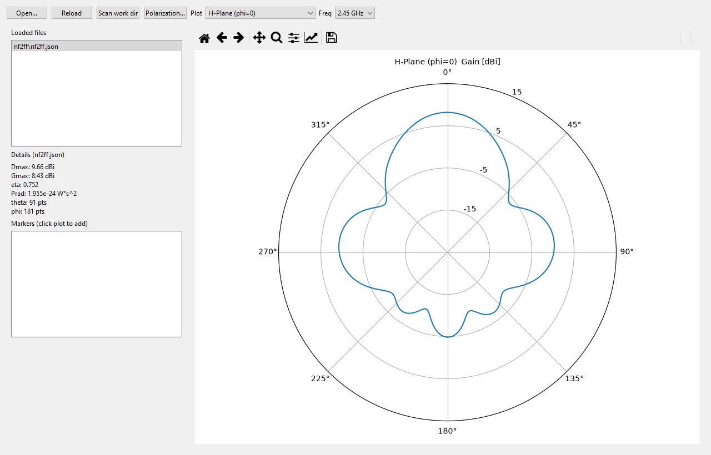
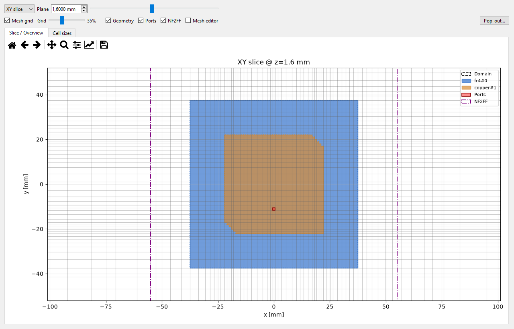
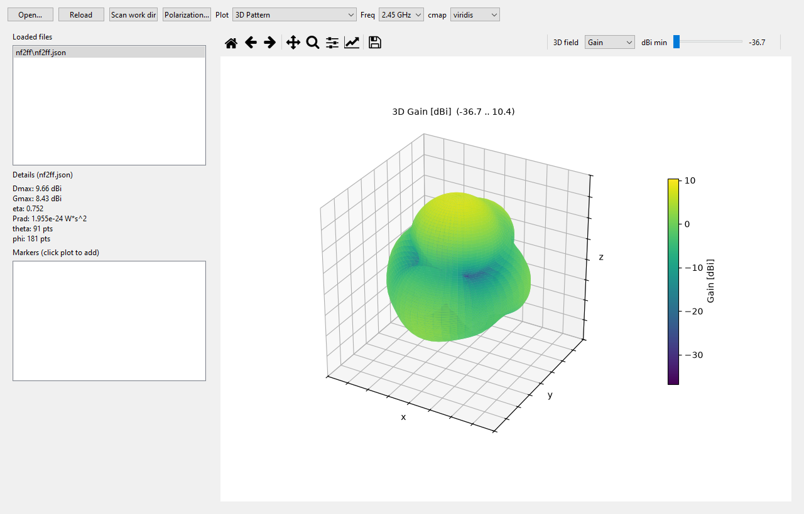
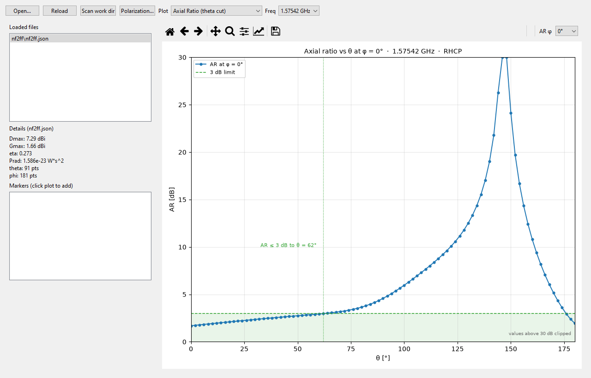
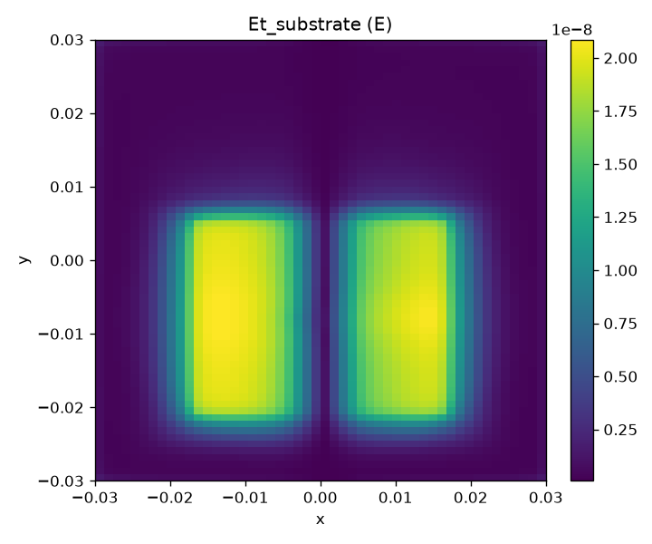

# VisualOpenEMS

> **⚠️ Pre-Alpha — Work in Progress**
>
> VisualOpenEMS is currently in **pre-alpha** development. The code is a work in progress and **not suitable for production use**. APIs, project file formats, and GUI layouts may change without notice. Simulation results should be independently verified.
>
> **Found a bug?** Please [open an issue](https://github.com/istra711/VisualOpenEMS/issues) with a description of the problem, steps to reproduce, and — if possible — a suggested fix or pull request. Contributions are welcome!

---

A standalone desktop GUI that takes 3D structures from **FreeCAD**, builds an **openEMS/CSXCAD** simulation model, runs **FDTD** simulations via Python bindings, and post-processes **S-parameters**, **field dumps**, and **NF2FF far-field patterns**.

Built with Python 3.11, PySide6 (Qt 6), and the openEMS/CSXCAD Python APIs.

---

## Table of Contents

- [Features](#features)
- [Screenshots](#screenshots)
- [Architecture](#architecture)
- [Requirements](#requirements)
- [Installation](#installation)
- [Quick Start](#quick-start)
- [Workflow](#workflow)
- [GUI Reference](#gui-reference)
- [Meshing Rules](#meshing-rules)
- [Project File Format](#project-file-format)
- [Script Editor](#script-editor)
- [Examples](#examples)
- [Tests](#tests)
- [Documentation](#documentation)
- [Changelog](CHANGELOG.md)
- [External Sources & Dependencies](#external-sources--dependencies)
- [License](#license)

---

## Features

### Geometry Import

- **FreeCAD** native `.FCStd` files — tessellated via FreeCADCmd into per-object triangle meshes
- **STEP** (`.step` / `.stp`) — axis-aligned boxes are emitted as exact openEMS boxes; everything else as STL polyhedra
- **STL** (`.stl`) — single file or folder of per-object STLs
- **OBJ** (`.obj`)
- **`openems_export.json`** manifest from the FreeCAD export tools
- **CSX primitives** — generic box, cylinder, polygon, and STL entries for non-FreeCAD workflows
- Port markings (`PORT_<name>_start` / `PORT_<name>_stop` points) are carried through from FCStd

### Mesh Generation

- **easyMesh** automated meshing with configurable presets (low / medium / high / custom)
- Enforces openEMS rules of thumb: max cell ≤ λ/10, smooth grading, 1/3–2/3 metal edge rule
- Metal-edge densification for cylindrical structures (custom fix — see [easyMesh Changes](docs/EASYMESH_CHANGES_EN.md))
- Separate min cell size for Z-axis (useful for flat PCB structures)
- Axis-restricted meshing (`xy`, `xz`, `xyz`, …)
- Arc detection and **graded mesh refinement at metal interfaces** (fine next
  to PEC, coarsening into the air/dielectric by the max grading ratio)
- Interactive mesh viewer with 3D scene and per-axis slice inspection
  (per-object colour, transparency and visibility, set in the object dialogs)
- **Mesh Editor** — add / edit / delete manual grid lines per axis directly in
  the slice (click to add, click a line to select, Shift+click to add several,
  snap to geometry edges, multi-select with Del, right-click menu). Edits apply
  to the *existing* mesh instantly (no easyMesh re-run, view kept) and to every
  rebuild; removals snap to the nearest line and are reported if the mesh moved.
  **New Scene (no mesh)** shows geometry + domain + NF2FF box on an empty grid so
  the mesh can be built by hand; **Rebuild from scratch** and **Delete Mesh**
  round it out.
- **Two status-bar progress bars** (side by side): timesteps and residual-energy
  convergence toward the end criterion (0 % = energy at start, 100 % = converged).

### Simulation

- FDTD via openEMS Python bindings (`FDTD` / `CSXCAD`)
- Configurable frequency range, excitation (Gaussian pulse f0/fc), boundary conditions (PML / Mur / periodic / PEC / PMC), air margin, and timestep limits
- Multi-threaded solver control (auto or manual thread count)
- Field dumps (Et/Hz time-domain, Ef/Hf frequency-domain) on configurable grids
- NF2FF (Near-Field to Far-Field) box with automatic positioning

### Post-Processing

- **S-Parameter Viewer** — Touchstone import, Smith chart, |S| dB, phase, VSWR; interactive markers; S-min jump; auto-opens after simulation
- **Antenna Viewer** — 3D gain pattern (axes labelled x/y/z), E/H cuts (Az/El), directivity, gain, radiation efficiency; HPBW and front-to-back analysis; **axial ratio** and **phase center** from the stored `E_theta`/`E_phi` (no re-run), including an **AR-vs-θ cut** at a selectable azimuth; pop-out plot windows
- **NF2FF Summary** — gain/directivity/efficiency plot per frequency
- **Field Viewer** — 3D field slices with per-axis navigation
- **VTK Viewer** — convert the HDF5 field dumps to VTK rectilinear grids
  (`.vtr`) and inspect them in an embedded 3D view (iso-surface of |field|,
  outline, configurable axes: View → Axes for corner marker, labels/font,
  size and a numeric coordinate ruler; ParaView-style vector glyphs: small
  arrows on the slice/surface/iso-surface that make the field motion visible
  during playback; export the sequence as an MP4 video with the current view
  settings); the `.vtr` files open in ParaView too. A per-step export also
  writes a ParaView collection (`<dump>.pvd`) with the physical time (TD) or
  frequency (FD) of every step, so ParaView plays the whole series from one file
- All viewers support export to PNG

### Workflow Automation

- Preset generators: **Patch Antenna**, **GPS L1 patch (CP)**, **Dipole**, **PCB Filter**, **Yagi Antenna**
- FreeCAD CAD export dialog (STEP or per-object STL)
- **STEP export for CAD / CST** (File → Export STEP…): writes the effective
  geometry (analytic boxes/cylinders/spheres/polygons + imported meshes) as an
  AP214 STEP file in mm. Object names are preserved as STEP product names, so
  the solids arrive in CST Studio Suite under the same names as in the Mesh
  Viewer. Zero-thickness metal sheets (e.g. the patch preset) become planar
  faces, and meshes become shells (solids when watertight).
- **Grid export (JSON)** (Mesh → Export grid (JSON)…): writes the built mesh
  lines per axis in mm (plus cell counts, min/max cell size and the FDTD
  domain) so another FDTD solver — e.g. CST — can run on identical cell
  boundaries.
- Simulation script editor with regenerate/revert workflow
- Project save/load (`.fcsim.json`) with backward-compatible deserialization

---

## Screenshots



*Antenna tab: polar cut with dBi rings, the NF2FF results found in the work
directory and the details block (Dmax, Gmax, η).*



*Mesh viewer: XY slice at the patch plane — the grid refines over the patch and
coarsens towards the λ/10 limit; grid, geometry, ports and the NF2FF box toggle
separately, a right click on a marked cell opens the repair actions.*



*3D gain pattern with the spatial axes labelled x/y/z; the radius follows the
"dBi min" window, the colour bar carries the absolute values.*

---

## Architecture

```
VisualOpenEMS/
├── app/
│   ├── main.py                    # GUI entry point (PySide6)
│   ├── paths.py                   # App root resolution
│   ├── settings.py                # Persistent app settings
│   ├── models/
│   │   └── project.py             # Project, MeshSpec, SimSpec, NF2FFDef, BoundarySpec, PortDef …
│   ├── csxcad_builder/
│   │   ├── builder.py             # CSXCAD model construction
│   │   ├── primitives.py          # Parametric antenna generators (patch, dipole, Yagi)
│   │   ├── quantize.py            # Coordinate quantization
│   │   └── triangle_mesh.py       # Triangle mesh → CSX.AddMesh
│   ├── freecad_io/
│   │   ├── freecad_launcher.py    # FreeCADCmd subprocess management
│   │   ├── freecad_mesh.py        # FCStd → per-object STL tessellation
│   │   ├── freecad_step_runner.py # Builds STEP shapes inside FreeCADCmd
│   │   ├── importer.py            # Unified geometry import (STEP/STL/OBJ/FCStd)
│   │   ├── port_marks.py          # PORT_* point → PortDef extraction
│   │   ├── step_export.py         # Geometry → STEP (mm, named products) for CST
│   │   └── stl_import.py          # STL file parsing and bounds
│   ├── meshing/
│   │   ├── easy_wrapper.py        # easyMesh Python integration
│   │   ├── grid_export.py         # Mesh lines → JSON (mm) for external solvers
│   │   ├── preview.py             # Mesh preview generation
│   │   ├── rules.py               # Mesh validation rules
│   │   └── validators.py          # Mesh quality checks
│   ├── simulation/
│   │   ├── runner.py              # Simulation process management
│   │   └── script_gen.py          # Project → project_run.py code generation
│   ├── postproc/
│   │   ├── fields.py              # Field dump post-processing
│   │   ├── nf2ff.py               # NF2FF far-field computation
│   │   └── sparams.py             # S-parameter extraction
│   └── ui/
│       ├── main_window.py         # Main window, menus, tabs
│       ├── mesh_params.py         # Mesh parameter dialog
│       ├── sim_params.py          # Simulation parameter dialog
│       ├── ports_dumps.py         # Ports & dumps dialog
│       ├── geometry_editors.py    # Port, material, primitive editors
│       ├── mesh_viewer.py         # 3D mesh visualization
│       ├── sparam_viewer.py       # S-parameter plots (scikit-rf)
│       ├── antenna_viewer.py      # Antenna pattern viewer
│       ├── script_editor.py       # Simulation script editor
│       ├── freecad_tools.py       # FreeCAD CAD export dialog
│       ├── tab_help.py            # Per-tab help system
│       └── freq_units.py          # Hz/kHz/MHz/GHz unit conversion
├── third_party/
│   └── easyMesh4openEMS/          # Git submodule — automated meshing engine
├── examples/                      # Runnable example scripts
├── tests/                         # Smoke tests and unit tests
├── docs/                          # Detailed documentation (EN/DE)
└── work/                          # Runtime output (git-ignored)
```

---

## Requirements

| Component | Version / Path | Source |
|-----------|---------------|--------|
| **Python** | 3.11.5 | [WinPython](https://www.winpython.org/) |
| **openEMS** (Python) | 0.0.36 | [openems.de](https://openems.de/) |
| **CSXCAD** (Python) | 0.6.3 | [openems.de](https://openems.de/) |
| **FreeCAD** | 1.1.4 | [freecad.org](https://www.freecad.org/) |
| **PySide6** | ≥ 6.5 | [pyside.org](https://doc.qt.io/qtforpython/) |
| **NumPy** | ≥ 1.26 | [numpy.org](https://numpy.org/) |
| **SciPy** | ≥ 1.11 | [scipy.org](https://scipy.org/) |
| **Matplotlib** | ≥ 3.8 | [matplotlib.org](https://matplotlib.org/) |
| **h5py** | ≥ 3.7 | [h5py.org](https://www.h5py.org/) |
| **scikit-rf** | ≥ 0.29 | [scikit-rf.org](https://scikit-rf.org/) |
| **easyMesh4openEMS** | fork (this repo) | [github.com/istra711/easyMesh4openEMS](https://github.com/istra711/easyMesh4openEMS) |

---

## Installation

### 1. Clone the repository

```bash
git clone --recurse-submodules https://github.com/istra711/VisualOpenEMS.git
cd VisualOpenEMS
```

### 2. Install Python dependencies

```powershell
pip install -r requirements.txt
```

### 3. Install openEMS / CSXCAD Python wheels

Download from [openems.de](https://openems.de/index.php/Downloads.html) or use local wheels:

```powershell
pip install C:\openEMS\python\CSXCAD-0.6.3-cp311-cp311-win_amd64.whl
pip install C:\openEMS\python\openEMS-0.0.36-cp311-cp311-win_amd64.whl
```

### 4. Install easyMesh4openEMS

```powershell
pip install .\third_party\easyMesh4openEMS
```

### 5. Verify installation

```powershell
python tests\verify_imports.py
```

---

## Quick Start

### Launch the GUI

```powershell
python app\main.py
```

### Load a preset

| Menu | Preset | Description |
|------|--------|-------------|
| **Presets → Patch Antenna…** | 2.45 GHz microstrip patch on FR4 | 2-port S-parameter sweep |
| **Presets → Dipole…** | Half-wave dipole | Basic antenna validation |
| **Presets → PCB Filter…** | Microstrip notch filter | 2-port, dual-excitation |
| **Presets → PCB Bandpass (5.6 GHz)…** | 5-pole Chebyshev stub band-pass on PTFE | 2-port, no vias |
| **Presets → PCB Hairpin Bandpass (2.4 GHz)…** | Compact 5-pole hairpin band-pass on RT/duroid 6010 | 2-port, no vias |
| **Presets → Yagi Antenna…** | 3-element Yagi | Directional antenna |

### Import your own geometry

1. **File → Import Geometry…** — select `.step`, `.fcstd`, `.stl`, `.obj`, or a folder
2. **Add Port…** — define lumped/waveguide ports
3. **Add Assignment…** — assign materials to objects
4. **Build Mesh** (Ctrl+M) — generate the FDTD mesh
5. **Run Simulation** (Ctrl+R) — execute the FDTD solver
6. View results in the **S-Params**, **Antenna**, and **Fields** tabs

---

## Workflow

```
┌─────────────┐    STEP/FCStd    ┌──────────────────┐
│   FreeCAD   │ ──────────────▶  │  Import Geometry  │
│  (draw 3D)  │   (or STL/OBJ)   │  (tessellation)   │
└─────────────┘                  └────────┬─────────┘
                                          │
                                          ▼
                                 ┌──────────────────┐
                                 │ Assign Materials  │
                                 │ Define Ports      │
                                 └────────┬─────────┘
                                          │
                                          ▼
                                 ┌──────────────────┐
                                 │   Build Mesh      │◀── easyMesh automation
                                 │   (FDTD grid)     │    (presets + rules)
                                 └────────┬─────────┘
                                          │
                                          ▼
                                 ┌──────────────────┐
                                 │  Run Simulation   │◀── openEMS FDTD solver
                                 │  (project_run.py) │    (Python bindings)
                                 └────────┬─────────┘
                                          │
                          ┌───────────────┼───────────────┐
                          ▼               ▼               ▼
                   ┌────────────┐  ┌────────────┐  ┌────────────┐
                   │ S-Params   │  │  Antenna   │  │  Fields    │
                   │ Viewer     │  │  Viewer    │  │  Viewer    │
                   │ (S11/S21)  │  │  (gain)    │  │  (E/H)     │
                   └────────────┘  └────────────┘  └────────────┘
```

---

## GUI Reference

### Main Window Layout

```
┌────────────────────────────────────────────────────────────────┐
│  File  Presets  FreeCAD  Mesh  Simulation  View  Help          │
├────────────────────────────────────────────────────────────────┤
│ [Geometry] [Mesh] [S-Params] [Antenna] [Fields] [Log] [Help]  │
├────────────────────────────┬───────────────────────────────────┤
│                            │  Project Tree                     │
│   Tab Content              │  ├─ Geometry Files                │
│   (viewers, mesh info,     │  ├─ Materials                     │
│    computed values)        │  ├─ Ports                         │
│                            │  └─ Dumps                         │
│                            │                                   │
│                            │  [Import…] [Add Port…] [Add Mat…] │
├────────────────────────────┴───────────────────────────────────┤
│  Log / Mesh Report / Scene Info                                │
└────────────────────────────────────────────────────────────────┘
```

### Keyboard Shortcuts

| Shortcut | Action |
|----------|--------|
| Ctrl+O | Open project |
| Ctrl+S | Save project |
| Ctrl+Shift+S | Save As |
| Ctrl+M | Open Mesh Parameters |
| Ctrl+R | Run Simulation |
| Ctrl+Shift+R | Run All Ports (full S-matrix) |

### S-Parameter Viewer

- **Open** — load `.s1p`/`.s2p` Touchstone or app `sparams.json`
- **Plot types** — Smith chart, |S| dB, |S| magnitude, Phase, VSWR, Re/Im
- **Markers** — click on plot; table shows f, |S|, dB, phase, VSWR
- **Go to S-min** — jump to the resonance dip
- **Pop out** — detach plot into a separate window
- Auto-opens after a simulation completes

### Antenna Viewer

- **3D gain** — spherical surface coloured by gain (dBi), spatial axes labelled
  x/y/z; the radius is normalised to the dBi window set by the slider, the colour
  bar carries the absolute values
- **E/H cuts** — Az/El plane cuts with polar plots
- **Axial-ratio cut** — AR against θ at a selectable azimuth (0…315°), with the
  3 dB band shaded and the widest angle that still meets it labelled
- **Polarization…** — axial ratio, CP sense, ellipse tilt and phase center per
  frequency, derived from the stored complex `E_theta`/`E_phi` (no re-run);
  copy as TSV
- **HPBW / VRV** — half-power beamwidth and front-to-back ratio of the current cut
- **Gain / efficiency vs frequency** — Dmax, gain, η and Prad over the NF2FF list
- **Pop out** — detach any plot into a separate window



*Axial ratio against θ for the GPS L1 preset at 1.57542 GHz (φ = 0°): 1.70 dB at
boresight, ≤ 3 dB out to θ = 62°. The selector in the plot toolbar chooses the
azimuth; the data comes from the `nf2ff.json` of the last run.*

### Field Viewer

- **Slices and iso-surfaces** of the field dumps, per-axis navigation
- **Vector glyphs** ("Vectors") that replace the coloured surface, so the arrows
  stay visible; "field underneath" brings the overlay back
- **Series playback** over the time or frequency steps, with an arrow-motion
  readout per step
- **Export** — VTK rectilinear grids (`.vtr`) plus a ParaView collection
  (`<dump>.pvd`), or MP4 with the current view settings



*|Et| in the substrate of the 2.45 GHz example, sliced from the field dump. The
post-processing writes such slices as PNG next to the dump; the interactive 3D
view with the vector glyphs lives in the Field Viewer tab.*

---

## Meshing Rules

The application enforces these openEMS meshing rules automatically:

| Rule | Description |
|------|-------------|
| **λ/10 limit** | Maximum cell size ≤ λ_min / 10 (openEMS rule of thumb) |
| **Preset targets** | low ≈ λ/10, medium ≈ λ/12, high ≈ λ/16 |
| **Grading ratio** | Neighbor cell ratio ≤ max_grading_ratio (default 2.0) |
| **Metal edge 1/3–2/3** | Additional mesh lines at metal edges (easyMesh) |
| **Cylinder ends** | Densification at both end-caps of cylinder primitives |
| **Port alignment** | 1D ports → one mesh line; 2D ports → one cell |
| **PML placement** | PML cells after air margin |
| **Drawing unit** | Consistent mm/µm/m throughout the model |

### Custom easyMesh Fixes

This fork includes local modifications to [easyMesh4openEMS](https://github.com/istra711/easyMesh4openEMS):

- **Cylinder-end densification** — pre-pass adds 5 mesh lines at both end-caps of every `CYLINDER` primitive (fixes interleaved edge gaps for Yagi antennas)
- **Bounds checks** — prevents `IndexError` in `smooth_and_process_mesh_lines` for STL polyhedron projects

See [docs/EASYMESH_CHANGES_EN.md](docs/EASYMESH_CHANGES_EN.md) for details.

---

## Project File Format

Projects are stored as `.fcsim.json` — a human-readable JSON file:

```json
{
  "name": "my_antenna",
  "version": 1,
  "geometry_files": [...],
  "materials": [...],
  "assignments": [...],
  "ports": [...],
  "dumps": [...],
  "nf2ff": {...},
  "mesh": {
    "preset": "high",
    "drawing_unit": "mm",
    "start_frequency": 2.2e9,
    "stop_frequency": 2.7e9,
    "target_frequency": 2.45e9,
    "refined_cellsize": null,
    "min_cellsize": null,
    "min_cellsize_z": null,
    "max_cellsize": null,
    "smooth_metal_edge": "one_third_two_thirds",
    "use_circle_detection": false,
    "use_arc_detection": false,
    "handle_closely_placed_edges": true,
    "max_grading_ratio": 2.0,
    "num_lines": 5,
    "dirs": "xyz",
    "add_graded_mesh_lines_at_material_transitions": true
  },
  "boundary": {...},
  "sim": {...},
  "primitives": [...]
}
```

**Backward compatibility:** unknown keys in older project files are silently ignored; missing keys fall back to defaults. On save, the file is rewritten in the current format.

---

## Script Editor

Every simulation generates `work/<project>/project_run.py` — a standalone, reproducible script.

**Simulation → Script…** opens a modeless editor with:

- **Save** — write changes back
- **Revert** — restore last saved state
- **Regenerate from project** — rebuild from GUI state (backs up your edits to `project_run_edited.py`)

Run the script directly:

```powershell
python work\my_antenna\project_run.py
```

---

## Examples

All examples are in `examples/` and runnable standalone:

| Script | Description |
|--------|-------------|
| `freecad_yagi_model_param.py` | Parametric Yagi antenna (editable `Part::Cylinder` objects) |
| `freecad_pcb_filter_model.py` | PCB notch filter (FreeCAD model) |
| `freecad_dipole_ports.py` | Dipole with port markings |
| `freecad_export_for_openems.py` | FreeCAD → openEMS export utility |
| `run_patch_example.py` | Patch antenna end-to-end |
| `run_pcb_filter_example.py` | PCB filter with dual excitation |
| `run_pcb_bandpass_example.py` | 5.6 GHz stub band-pass (PTFE) |
| `run_pcb_hairpin_example.py` | 2.4 GHz hairpin band-pass (RT/duroid 6010) |
| `run_stl_import_example.py` | Headless STL import |
| `run_yagi_example.py` | Yagi antenna simulation |

Run an example:

```powershell
python examples\run_yagi_example.py
```

---

## Tests

### Quick verification

```powershell
python tests\verify_imports.py    # All imports OK?
python tests\test_models.py       # Dataclass serialization round-trip
```

### Smoke tests (headless)

```powershell
$env:QT_QPA_PLATFORM="offscreen"
python tests\menu_smoke.py
python tests\sim_params_smoke.py
python tests\mesh_viewer_smoke.py
python tests\sparam_viewer_smoke.py
python tests\antenna_viewer_smoke.py
python tests\script_editor_smoke.py
python tests\tab_help_smoke.py
python tests\tree_edit_smoke.py
```

### Physics tests

```powershell
python tests\smoke_patch.py       # Patch antenna S11
python tests\stl_import_smoke.py  # STL import + mesh
python tests\yagi_mesh_ends.py    # Yagi cylinder-end densification
```

---

## Documentation

| Document | Description |
|----------|-------------|
| [docs/ANLEITUNG_EN.md](docs/ANLEITUNG_EN.md) | Full guide: FreeCAD antenna → simulation (EN) |
| [docs/ANLEITUNG_DE.md](docs/ANLEITUNG_DE.md) | Full guide (DE) |
| [docs/FREECAD_WORKFLOW_EN.md](docs/FREECAD_WORKFLOW_EN.md) | Step-by-step workflow checklist (EN) |
| [docs/FREECAD_PORTS_EN.md](docs/FREECAD_PORTS_EN.md) | Port marking in FreeCAD (EN) |
| [docs/EASYMESH_CHANGES_EN.md](docs/EASYMESH_CHANGES_EN.md) | Local easyMesh modifications (EN) |
| [docs/DIAGNOSTICS_CHANGES_EN.md](docs/DIAGNOSTICS_CHANGES_EN.md) | Mesh diagnostics: timing, run status, critical cells, fine-cell sources, coordinate quantization, cell repair (V1–V4) (EN) |
| [docs/DIAGNOSTICS_CHANGES_DE.md](docs/DIAGNOSTICS_CHANGES_DE.md) | Same, German — with the measurements over the real projects (DE) |
| [CHANGELOG.md](CHANGELOG.md) | Full change history per release |

The German guide is also available as a Word document and as a LibreOffice
document: [ANLEITUNG_DE.docx](docs/ANLEITUNG_DE.docx),
[ANLEITUNG_DE.odt](docs/ANLEITUNG_DE.odt). Both are generated from the Markdown
source with `python examples/build_anleitung_docx.py --odt` (the ODT step uses a
headless LibreOffice; without one it is skipped).

---

## External Sources & Dependencies

VisualOpenEMS builds on the following open-source projects:

### Core Simulation Engine

| Project | License | Source | Usage |
|---------|---------|--------|-------|
| **openEMS** | GPLv3 | [openems.de](https://openems.de/) · [github.com/thliebig/openEMS](https://github.com/thliebig/openEMS) | FDTD time-domain electromagnetic solver |
| **CSXCAD** | LGPLv3 | [openems.de](https://openems.de/) · [github.com/thliebig/CSXCAD](https://github.com/thliebig/CSXCAD) | Continuous Structure library for openEMS (geometry, materials, ports) |

### Mesh Generation

| Project | License | Source | Usage |
|---------|---------|--------|-------|
| **easyMesh4openEMS** | GPL-3.0 | [github.com/MustafaAlchalabi/easyMesh4openEMS](https://github.com/MustafaAlchalabi/easyMesh4openEMS) | Automated FDTD mesh generation with metal-edge densification, grading, and arc detection. This repo uses a [fork](https://github.com/istra711/easyMesh4openEMS) with local fixes. |

### CAD / Geometry

| Project | License | Source | Usage |
|---------|---------|--------|-------|
| **FreeCAD** | LGPLv2.1 | [freecad.org](https://www.freecad.org/) · [github.com/FreeCAD/FreeCAD](https://github.com/FreeCAD/FreeCAD) | 3D parametric CAD modeler; geometry source for STEP/FCStd import |

### Python Libraries

| Library | License | Source | Usage |
|---------|---------|--------|-------|
| **NumPy** | BSD-3-Clause | [numpy.org](https://numpy.org/) · [github.com/numpy/numpy](https://github.com/numpy/numpy) | Array operations, mesh data |
| **SciPy** | BSD-3-Clause | [scipy.org](https://scipy.org/) · [github.com/scipy/scipy](https://github.com/scipy/scipy) | Signal processing, interpolation |
| **Matplotlib** | PSF-based | [matplotlib.org](https://matplotlib.org/) · [github.com/matplotlib/matplotlib](https://github.com/matplotlib/matplotlib) | Plotting (S-params, fields, patterns) |
| **h5py** | BSD-3-Clause | [h5py.org](https://www.h5py.org/) · [github.com/h5py/h5py](https://github.com/h5py/h5py) | HDF5 field dump reading |
| **PySide6** | LGPL-3.0 | [pyside.org](https://doc.qt.io/qtforpython/) · [github.com/pyside/PySide6](https://github.com/pyside/PySide6) | Qt 6 GUI bindings |
| **scikit-rf** | BSD-3-Clause | [scikit-rf.org](https://scikit-rf.org/) · [github.com/scikit-rf/scikit-rf](https://github.com/scikit-rf/scikit-rf) | Touchstone file parsing, network analysis |
| **Qt (PySide6)** | LGPL-3.0 | [qt.io](https://www.qt.io/) · [github.com/qt/qtbase](https://github.com/qt/qtbase) | Cross-platform GUI framework |

### Data Formats

| Format | Specification | Usage |
|--------|--------------|-------|
| **Touchstone** | [IBIS Open](https://www.ibis.org/touchstone_ver2.0/touchstone_ver2_0.pdf) | S-parameter file exchange (`.s1p`, `.s2p`, …) |
| **HDF5** | [hdfgroup.org](https://www.hdfgroup.org/solutions/hdf5/) | openEMS field dump storage |
| **STEP** | [ISO 10303](https://www.iso.org/standard/38218.html) | CAD geometry exchange |
| **STL** | [wikipedia.org/wiki/STL_(file_format)](https://en.wikipedia.org/wiki/STL_(file_format)) | Triangle mesh interchange |

---

## License

| Component | License |
|-----------|---------|
| **VisualOpenEMS** (this code) | See repository license |
| **openEMS** | [GPLv3](https://www.gnu.org/licenses/gpl-3.0.html) |
| **CSXCAD** | [LGPLv3](https://www.gnu.org/licenses/lgpl-3.0.html) |
| **easyMesh4openEMS** | [GPL-3.0](https://www.gnu.org/licenses/gpl-3.0.html) |
| **FreeCAD** | [LGPLv2.1](https://www.gnu.org/licenses/old-licenses/lgpl-2.1.html) |

> **Note:** openEMS and easyMesh4openEMS are GPL-3.0 licensed. If you distribute a combined work, the GPL-3.0 terms apply to the whole. Consult a lawyer for commercial distribution.

---

## Contributing

1. Fork the repository
2. Create a feature branch: `git checkout -b feature/my-feature`
3. Commit changes: `git commit -am 'Add my feature'`
4. Push to the branch: `git push origin feature/my-feature`
5. Create a Pull Request

---

## Acknowledgements

- **openEMS** by Thorsten Liebig and contributors — the FDTD engine that makes this project possible
- **CSXCAD** by Thorsten Liebig — the continuous structure library
- **easyMesh4openEMS** by Mustafa Alchalabi — automated mesh generation
- **FreeCAD** community — the parametric CAD platform
- **scikit-rf** — Touchstone and network analysis toolkit
