# Guide: Draw an antenna in FreeCAD and simulate it with the GUI

**Project:** FreeCAD OpenEMS GUI  
**Goal:** model a 3D antenna in FreeCAD, import it as STEP, simulate with openEMS and evaluate the S-parameters  
**GUI language:** English (guide: English)

---

## 1. Overview

| Step | Tool | Result |
|------|------|--------|
| Draw antenna | FreeCAD | FCStd / STEP |
| Export | FreeCAD → Export STEP | `.step` |
| Import | GUI **Import Geometry…** or **FreeCAD…** | Triangle meshes + stl primitives |
| Terminations | **Add Port…**, **Add Assignment…** | 50 Ω port, material |
| Simulation | **Build Mesh** → **Run Simulation** | S-params, fields |
| Evaluation | **S-Params Viewer**; **Antenna** tab | S11/S21, Smith, markers; pattern (gain/directivity) |

**Important:** openEMS does not read BREP-STEP directly. The GUI tessellates the CAD into triangle meshes automatically (`CSX.AddMesh`).

**Compact step-by-step guide (FreeCAD → Geometry → Ports → Import → Simulation):**
**[docs/FREECAD_WORKFLOW_EN.md](FREECAD_WORKFLOW_EN.md)** — with checklist and error table.
Details on port marking only: **[docs/FREECAD_PORTS_EN.md](FREECAD_PORTS_EN.md)**.

---

## 2. FreeCAD: draw the antenna

Recommendation: **one solid = one object**, with a clear name (it becomes the name in the project later).

### 2.1 Units

- FreeCAD: **View → Units** → **mm**
- Draw objects in mm (GUI default `drawing_unit=mm`)

### 2.2 Concrete example: patch antenna 2.45 GHz (FR4, εr≈4.4, h=1.6 mm)

Orientation: **Z = height**, patch in the XY plane.

| Part | Dimensions (mm) | FreeCAD tip |
|------|-----------------|-------------|
| Substrate | 60 × 60 × 1.6 | Box, position z = 0…1.6 |
| Ground (GND) | 60 × 60 × 1 | Box, z = −1…0 |
| Patch | ~36 × 28 × 1 | Box on substrate, z = 1.6…2.6 |
| Feed point | 5–7 mm from the patch edge | later port definition |

**Names in the model** (object tree): `gnd`, `substrate`, `patch`.

**Port (lumped):**  
Lumped port on an edge of the patch: start/stop on the patch, 50 Ω, direction `x` or `y` (set later in the GUI).

**Mark ports already in FreeCAD (recommended):**  
Create points `PORT_in1_start` / `PORT_in1_stop` → the import adds the port automatically.  
Step-by-step: **[docs/FREECAD_PORTS_EN.md](FREECAD_PORTS_EN.md)**

### 2.3 Wire / Yagi structure (alternative)

- **Preset: Yagi Antenna…** in the GUI (reference, 2.45 GHz) or FreeCAD cylinders / Part tools
- Yagi coordinate system: **X = elements, Y = boom, Z = up**
- Driven dipole with a gap → the port sits there

### 2.4 FreeCAD export

1. **File → Export…**
2. Type: **STEP** (`*.step` / `*.stp`) — recommended
3. Save to e.g.
   `C:\Users\istra\Documents\claude_ps\FreeCAD_OpenEMS_GUI\work\freecad_export\antenna.step`
4. Optionally also save **FCStd** or export **STL**

---

## 3. Start the GUI

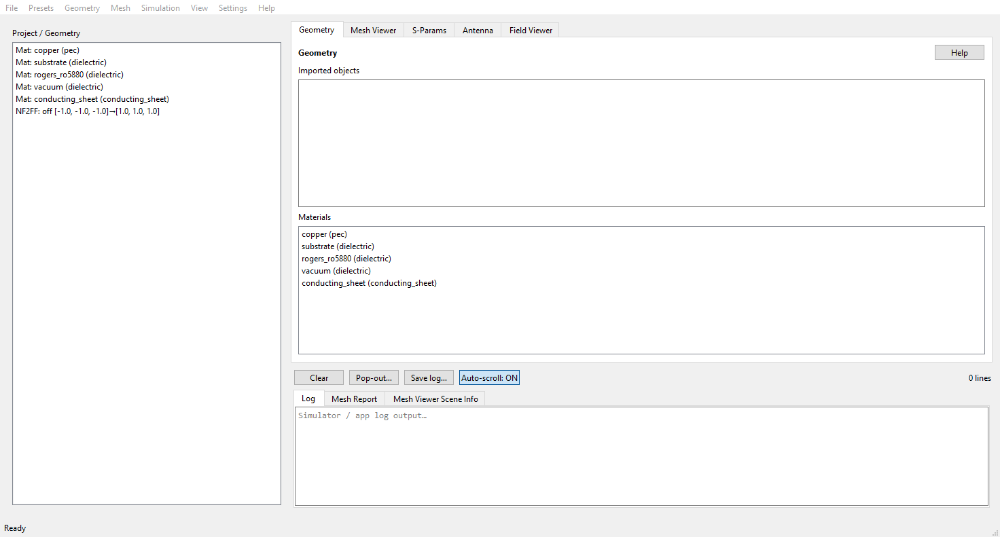

**Main window after start.** Tabs Geometry / Mesh Viewer / S-Params / Antenna / Field Viewer, the project tree on the left, the import and material panels in the middle, log and mesh report at the bottom.


```text
C:\Users\istra\Documents\claude_ps\FreeCAD_OpenEMS_GUI
python app\main.py
```

**Menu bar:** `File` (New/Open/Save, Import Geometry, Open Work Folder, Exit),
`Project` (Presets), `Geometry` (Box/Cylinder/Port/Dump, Ports / Dumps… = **Ctrl+Shift+D**, Edit/Duplicate/Delete Selected = **Ctrl+D**/**Del**, Fit NF2FF — the same via right-click on a tree entry),
`Mesh` (`Build CSX + Mesh + Validate` = **Ctrl+M**), `Simulation` (`Run Simulation` = **Ctrl+R**, Script,
S-Params Viewer, Antenna Pattern Viewer / Pop-out Antenna Graph),
`View` (Tabs, Log Panel = **Ctrl+L**, Project / Geometry Panel = **Ctrl+B**),
`Tools` (Settings…),
`Help` (Help = **F1**, ANLEITUNG, README, About).

The **Project / Geometry panel** on the left (the tree) can be hidden and shown
again with a **right-click** on the empty area below the tree or via `View` →
**Project / Geometry Panel** (**Ctrl+B**); the state is remembered.

The **log panel** (below the tabs, toggled with **Ctrl+L**) has two
tabs: **Log** (openEMS/app log) and **Mesh Report** (the mesh-check report,
single source after a build). **Right-click anywhere in the log area** (text,
tab bar, button row, line counter or the divider above it) for the log options:
show/hide the Log and the Project / Geometry panel, pick a log tab, auto-scroll,
Save log…, Pop out log…. In the text, Copy / Select All are above them. The same
menu sits on the status bar at the bottom edge.

**Settings…** (once):

| Field | Value |
|-------|-------|
| FreeCADCmd | `c:\FreeCAD_1.1.4-Windows-x86_64\bin\FreeCADCmd.exe` |
| FreeCAD GUI | `c:\FreeCAD_1.1.4-Windows-x86_64\bin\FreeCAD.exe` |
| Simulation Python | `c:\Python\WPy64-31150\python-3.11.5.amd64\python.exe` |
| openEMS root | `c:\openEMS` |
| Work dir | `C:\Users\istra\Documents\claude_ps\FreeCAD_OpenEMS_GUI\work` |

---

## 4. Bring the model into the GUI

### Variant A — import (standard)

1. **Import Geometry…**
2. Choose the file: `.step` / `.stp` / `.fcstd` / `.stl` / `.obj` / `openems_export.json`
   (a folder of per-object STLs, e.g. `stl/`, also works)
3. FreeCADCmd tessellates STEP/FCStd → `.npy` meshes; STL/manifests are loaded
   directly — **one primitive per FreeCAD object**, object names are preserved
4. Objects appear as **stl primitives** (default material: copper / PEC)
5. Check the log: mesh paths, any WARNINGS

### Variant B — FreeCAD tools in the GUI

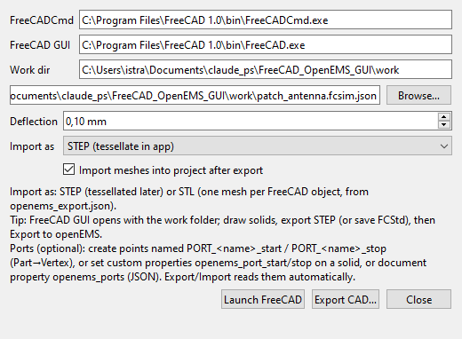

**FreeCAD tools.** Paths to FreeCADCmd and the FreeCAD GUI (example), work directory, deflection and import format. **Launch FreeCAD** opens FreeCAD with this work folder, **Export CAD…** writes STEP/STL into the project.

1. **FreeCAD…**
2. **Launch FreeCAD** (opens FreeCAD, cwd = work dir) — draw/edit, export STEP
3. **Export CAD…**
   - Source: `.fcstd` (preferred — object names are preserved) or `.step`
   - **Import as:** `STEP` (the app tessellates it later) or
     `STL (one mesh per FreeCAD object)` (uses `openems_export.json`,
     no FreeCAD needed at simulation time)
   - Deflection: 0.1 mm (default)
   - Check **Import meshes into project after export**
4. OK → export → auto-import into the project

Headless (without GUI):

```powershell
c:\Python\WPy64-31150\python-3.11.5.amd64\python.exe examples\run_stl_import_example.py
```

### Variant C — preset (only to test the simulation)

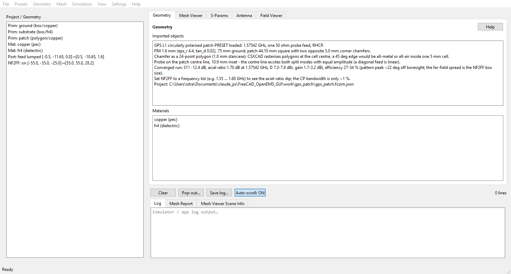

**After loading the preset.** Project tree with ground, substrate and patch, materials, port and NF2FF box; the geometry text carries the preset's figures and the hint how to make the axial-ratio dip visible with a frequency list.


1. **Preset: Patch Antenna…**, **Preset: Yagi Antenna…** or **Preset: PCB Filter…**
2. **PCB Filter** = 2-port microstrip notch filter on FR4 (stopband at 2.45 GHz):
   two lumped ports, so the example measures both S-matrix columns.
   The geometry comes from **FreeCAD** (FCStd → STL, 35 µm copper); `--analytic`
   uses the analytic box primitives for comparison instead

```powershell
c:\Python\WPy64-31150\python-3.11.5.amd64\python.exe examples\run_pcb_filter_example.py
```

Result (`work\pcb_filter\simulation\`): FreeCAD run **−29.99 dB at 2.450 GHz**
target, insertion −0.72 dB at 0.3 GHz; analytic run −28.96 dB at 2.429 GHz
(0.9 % difference = real 35 µm copper layer vs. zero-thickness trace in the tutorial).

Notes:

- **Axis-aligned** FreeCAD solids are created as openEMS **boxes** (exact
  metal edges on the grid lines), everything else stays an STL
  `PolyhedronReader`. In-memory `Polyhedron` primitives are **not** simulated
  by openEMS (warning *Unused primitive*).
- `[WARNING] grading_jump: Axis z 9.14` is normal: the 35 µm copper forces
  0.035 mm cells next to the 0.32 mm substrate cells — just a warning,
  exit code 0.
- `Max. number of timesteps was reached` is expected here; the stopband is
  stable (0.019 dB change from 50 000 to 150 000 steps, `work\pcb_filter_conv`).

#### PCB band-pass 5.6 GHz (five stubs, Teflon)

**Preset: PCB Bandpass (5.6 GHz)…** loads a 5-pole Chebyshev band-pass
(0.1 dB ripple) on **PTFE/Teflon** (0.254 mm, eps_r 2.1, tan_d 0.0002, 35 µm
copper). Five **open lambda/2 stubs** hang off a 50 ohm line, separated by four
**lambda/4 connecting lines** acting as impedance inverters — no vias, so the
board stays single-sided planar.

| Element | Z (ohm) | Width (mm) | Length (mm) |
|---|---|---|---|
| Stub 1 / 5 (outer) | 50.8 | 0.80 | 18.37 |
| Stub 2 / 4 | 15.0 | 3.74 | 18.69 |
| Stub 3 (centre) | 68.0 | 0.50 | 22.91 |
| Line 1 / 4 | 43.9 | 1.01 | 11.78 |
| Line 2 / 3 | 61.0 | 0.60 | 8.04 |

```powershell
c:\Python\WPy64-31150\python-3.11.5.amd64\python.exe examples\run_pcb_bandpass_example.py
```

Result (`work\pcb_bandpass\sparams\`): **|S11| < -10 dB from 4.90 to 6.45 GHz**,
passband **-0.1 … -0.3 dB**, rejection **-42 dB at 4.0 GHz** and **-38 dB at
7.2 GHz** (two FDTD runs, one S-matrix column each, merged; ~80 s per port on
8 cores).

Notes:

- The mesh uses `min_cellsize = 0.15 mm` (narrowest stub 0.50 mm) and
  `min_cellsize_z = 0.085 mm` (three cells through the 0.254 mm substrate).
- `smooth_metal_edge = False` and `handle_closely_placed_edges = False`:
  otherwise easyMesh creates a 4 µm cell between the 0.41 mm and 0.50 mm wide
  trace edges, shrinking the CFL time step by a factor of 8 (the simulation
  never decays).
- Stub band-passes are inherently wideband; the spurious pass-band near 2*f0 is
  a property of the topology, not a meshing artefact.

#### PCB hairpin band-pass 2.4 GHz (five folded resonators, RT/duroid)

**Preset: PCB Hairpin Bandpass (2.4 GHz)…** loads a 5-pole Chebyshev band-pass
(0.1 dB ripple, 10 % bandwidth → 2.28–2.52 GHz) on **RT/duroid 6010LM**
(1.27 mm, eps_r 10.2, tan_d 0.0023, 35 µm copper). Five **folded lambda/2
resonators** (hairpins) couple side by side along their arms — no vias, no
stubs, copper area only 25.1 x 14.3 mm.

| Item | Value |
|---|---|
| Centre frequency f0 / bandwidth | 2.40 GHz / 10 % |
| lambda_g in the odd mode | 51.23 mm (eps_eff = 5.946) |
| Strip width (all arms) | 1.186 mm (50 ohm) |
| Arm length | 11.814 mm |
| Inner gap between the U arms | 0.80 mm |
| Fold outer / electrical | 3.172 / 1.986 mm |
| Coupling gaps s0…s5 | 0.316 / 1.387 / 1.753 / 1.753 / 1.387 / 0.316 mm |
| J-inverters (normalised) | 0.370 / 0.125 / 0.096 / 0.096 / 0.125 / 0.370 |
| Z0e / Z0o | 75.4/38.3 · 57.1/44.5 · 55.2/45.7 ohm |

Synthesis: the two arms of one hairpin carry opposite currents, so the
resonator runs in the **odd mode** of the arm pair. The arm length therefore
uses eps_eff,odd = 5.946 (not the single-line eps_eff — that makes the arms
~15 % too short). The gaps come from the Hammerstad-Jensen even/odd model via
the J-inverters of the Chebyshev prototype; the strip width stays uniform and
only the gap sets the coupling.

```powershell
c:\Python\WPy64-31150\python-3.11.5.amd64\python.exe examples\run_pcb_hairpin_example.py
```

What is verified is the **single resonator**: one hairpin (arm 11.814 mm, feed
coupling 0.316 mm) resonates at **2.365 GHz** with **S21 = -0.16 dB** and
**S11 = -47.6 dB**; the skirt width gives Qe ~ 12.5 (synthesis: 13.1).

Notes:

- **Runtime:** the DFT resolution is 1/T_sim. A 240 MHz pass-band with ~50 MHz
  mode spacing needs T_sim >~ 60 ns (>~ 1.2 M steps). With tan_d = 0.0023
  (Q0 ~ 435) the stop-band decays very slowly. The preset therefore stops at
  `end_criteria = 1e-4` (-40 dB) and `max_timesteps = 600_000`.
- **Validation status:** single resonator and single coupling are verified in
  FDTD. Short runs (< 200 k steps) do not resolve the filter's mode spacing and
  then show no clean pass-band — extend the run as described above for the full
  5-pole curve.
- Mesh: `min_cellsize = min(s)/3 = 0.105 mm`, the 1.387 mm gap is resolved by
  four cells, strip edges sit on grid lines (`edges2grid = "xy"`).

---

## 5. Configure the project

### 5.0 Simulation parameters (own window)

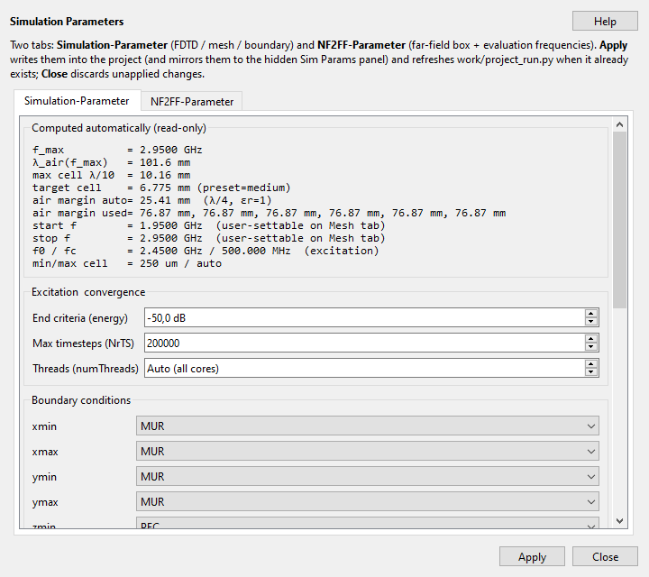

**Simulation Parameters.** Two tabs; the computed values on top (f_max, λ, cell sizes, air margin), below them the end criterion, timesteps, threads and boundary conditions.


**Menu → Simulation → Simulation Parameters…** (or **Ctrl+Shift+P**) opens a
separate, movable window with **all** simulation parameters — two tabs:

| Tab | Contents |
|-----|----------|
| **Simulation-Parameter** | Computed (read-only), excitation & convergence (end criteria, NrTS), boundary conditions ×6 + PML, air margin, mesh overrides, patch geometry |
| **NF2FF-Parameter** | Enable far-field (NF2FF), **evaluation frequencies** (mode: *Auto (S11 minimum)* / *N points (mesh range)* / *Frequency list*), θ/φ steps, Fit/Edit NF2FF box |

**Evaluation frequencies** (NF2FF tab) select at how many frequencies the
far field is recomputed:

| Mode | Effect |
|------|--------|
| **Auto (S11 minimum)** | one frequency at the S11 dip (or the target frequency) |
| **N points (mesh range)** | N points equally spaced over the mesh frequency range (start/stop from the Mesh tab) — e.g. 11 points from 2.0…2.8 GHz → *Gain vs Frequency* curve in the Antenna tab |
| **Frequency list** | explicit list, each entry with a unit **Hz / kHz / MHz / GHz** (bare number = Hz), e.g. `2.4 GHz, 2.45 GHz, 2500 MHz` |

| Button | Effect |
|--------|--------|
| **Apply** | Writes the values into the project, mirrors them into the hidden Sim Params panel (save/build use it) and refreshes `work/<project>/project_run.py` when it already exists (a visible Script editor reloads the file unless it holds unsaved edits) |
| **Close** | Discards unapplied changes |

The window is **modeless** — a second menu click brings the same window
to the front and syncs it with the current project. Changes take effect only
after **Apply**; then **Build Mesh** so the mesh picks them up.

**Menu → Mesh → Mesh Parameters…** (or **Ctrl+Shift+M**) opens a
separate, movable window with **all** mesh parameters (preset, drawing unit,
f0/fc, start/stop, air margin). **Apply** writes them into the project and
mirrors them into the hidden mesh form, **Close** discards unapplied changes.
This window is also **modeless**.

### 5.1 Mesh / frequencies

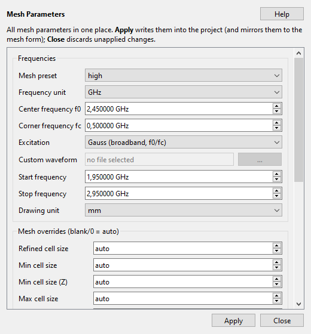

**Mesh parameters.** Preset, frequency range (f0/fc), excitation and the cell-size overrides in one place; **Apply** writes them into the project.

Mesh parameters (see §5.0):

| Parameter | Patch 2.45 GHz | Yagi 2.45 GHz |
|-----------|----------------|---------------|
| start_frequency | 2.2e9 | 2.2e9 |
| stop_frequency | 2.7e9 | 2.7e9 |
| target_frequency | 2.45e9 | 2.45e9 |
| drawing_unit | mm | mm |
| max_timesteps | 150000+ | 25000 (preset) |

**Coordinate alignment (default: on).** *Mesh Parameters* has "Align coordinates
(float32 grid)": every geometry coordinate then sits on the same float32 grid
CSXCAD uses for boxes/ports/dumps — triangle meshes from STEP/STL/FCStd included.
A vertex and a box face that are meant to be equal are bit-identical (no second
grid point, no sliver cell that collapses the timestep). Switching it off
restores the old behaviour (triangle meshes rounded decimally to 0.1 µm), which
is only useful for A/B comparisons. Stored `.npy` meshes keep their old rounding
until they are re-imported.

**Fine-cell attribution (P2, default: on).** The checkbox "Attribute fine cells
to their source" writes the geometry that forces each flagged cell onto the mark
(e.g. `box:feed + manual`) — visible in the Mesh Viewer marks and in the report
under "Fine-cell sources". Cells without an authored source come from easyMesh
itself (circle/arc detection, grading, PML transition).

**Critical cells in the Mesh Viewer (default: off).** Right-click →
"Mark critical cells (N)" shows the cells that cost runtime: the smallest
cell of each axis (they set the timestep), cells below the requested minimum size
and — after a run — the cell the solver reports as the smallest timestep. They
appear as dashed outlines in the slices (the grid stays visible) and as bands in
the *Cell sizes* plots; consecutive cells are merged into one region. Grading
jumps and too-large cells stay in the mesh report only. The marks are always
computed but drawn only on request; the count in the menu entry tells you
beforehand whether there is anything to see.

**Repairing cells (opt-in, preview first).** Right-click a mark →
"Critical cells (N open)" offers: *Repair this x/y/z region…* (preview with the
lines removed, the new smallest cell and dt before/after; OK stores the rule in
the project), *Remove the offending line…* (delete one auto line), *Snap onto the
neighbour line…* (duplicate-scale slivers only), *Accept region (do not repair)*
(grey, no longer counted as an open finding) and *Explain…* (cause, source,
runtime penalty). Only unprotected lines are touched; a cell with two geometry
faces stays and is reported as `geometry`. The repair runs as the last step of
the mesh build — the preview and the generated solver script produce the same
grid.

**Enforcing the min cell size (V2, default: off).** In *Mesh Parameters*,
"Enforce min cell size (repair)" turns "Min cell size" into a hard lower bound
("Min cell size (Z)" overrides the layer thickness): cells below it are merged
into the smaller neighbour and the grading is re-spaced; genuine gaps (both faces
from the geometry) stay and are reported as "not reached". The switch is opt-in
so existing presets stay reproducible; easyMesh no longer sees the floor (it
would otherwise refine the lateral axes against the repair).

Both are also in the **Mesh menu** under *Critical cells (N open)*: overlay
toggle, repair/remove/snap/accept/explain for the worst open finding and the
enforcement switch. The actions are only enabled where the right-click menu
would enable them too.

Full description: **F1 → "Mesh Repair"** (also the Help button in the repair
preview and Help → "Mesh repair (critical cells)…").

### 5.2 Material / assignment

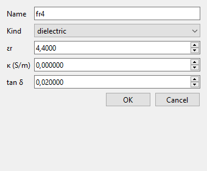

**Material.** Kind (dielectric / pec), εr, κ and tan δ — FR4: εr 4.4, tan δ 0.02; copper as pec.

1. **Add Material…** — e.g. `substrate` (εr=4.4, tanδ=0.02), `copper`
2. **Add Assignment…**
   - Object: `substrate` (or the substrate name from the import)
   - Role: `dielectric` / `pec` / `conductor` …
   - Choose the material
3. The assignment syncs stl primitives (pec → copper, dielectric → substrate …)

### 5.3 Port

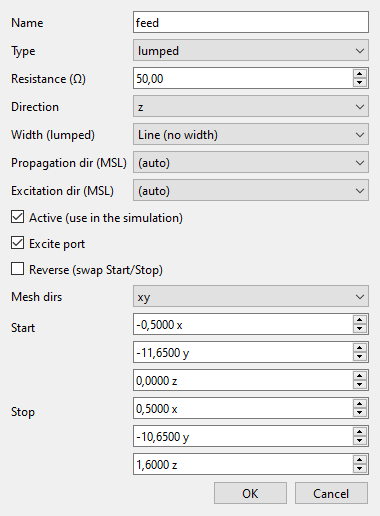

**Port.** Lumped, 50 Ω, direction, mesh dirs and start/stop in mm. Example: the probe port of the GPS preset — 1 mm × 1 mm from the ground plane (z = 0) to the patch top (z = 1.6 mm).

1. **Add Port…**
2. Type: **lumped** (patch) — resistance **50**
3. start / stop: edge of the patch (mm), e.g.
   `start=[-1.0, 0.0, -1.0]`, `stop=[1.0, 0.0, 1.0]`
4. Direction: `x` or `y` (parallel to the voltage drop across the port)
5. `excite_port = true` (port 1)
6. Check the geometry: viewer / mesh preview

**Alternative (FreeCAD):** mark ports as `PORT_*` points in the FCStd — they then appear automatically on import.  
→ **[docs/FREECAD_PORTS_EN.md](FREECAD_PORTS_EN.md)**

### 5.4 NF2FF (radiation pattern)

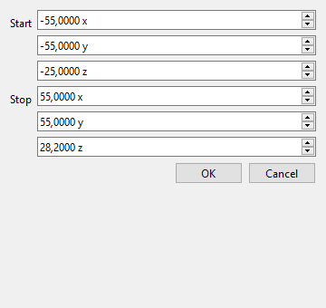

**NF2FF box.** Start/stop in mm; it has to enclose the antenna and its beam. Example: the GPS preset's box (±55 mm, z −25 … 28.2 mm). **Fit NF2FF to Geometry** sets it automatically.

1. **Edit NF2FF Box…** or **Fit NF2FF to Geometry**
2. Box around the antenna, e.g. start `[-40,-40,-20]`, stop `[40,80,20]`, center `[0,20,0]`
3. `enabled = true`
4. Pick the **evaluation frequencies** (Sim Params → NF2FF tab, see §5.0):
   *Auto* (one frequency at the S11 minimum), *N points* (Gain vs Frequency
   curve) or an explicit list with units (e.g. `2.4 GHz, 2.45 GHz`).
5. The **mesh viewer** shows the new box immediately (violet dash-dot line) —
   provided the mesh has already been built; the black dashed line is the
   simulation domain and only changes on the next **Build Mesh**.

### 5.5 Save the project

**Save…** → e.g. `work\my_antenna\antenna.fcsim.json`

### 5.6 Domain size (black frame in the mesh viewer)

The domain cannot be edited directly — it results from **geometry + air margin +
grid rounding**. Levers:

| Lever | Effect |
|-------|--------|
| **Air margin auto** (Sim Params → Boundary conditions) | λ/4 at the **stop frequency**, always εr=1 (at 2.7 GHz = 27.76 mm per face). Changing the stop frequency therefore also changes the margin |
| **Air margin (all faces)** | Auto off → fixed value in mm for all 6 faces. In the project JSON settable as a 6-element list `boundary.air_margin` = `[xmin,xmax,ymin,ymax,zmin,zmax]` per face (the GUI writes the same value for all) |
| **Geometry** | Domain = geometry bbox + margin (easyMesh `boundary_distance`) |
| **PML size** | per PML face easyMesh adds `PML_size + 1` cells **outside** → larger domain. Only effective for boundary = PML; no effect for MUR |
| **Mesh preset / min cell size** | Air cells grow to λ/10…λ/40 per preset (`max_cellsize_air`) → the outer grid line is rounded to that: deviation of a few mm, slightly different per side (that is the small asymmetry of the black line) |

**Procedure:** change values → **Build Mesh** (black line updates) →
**Fit NF2FF to Geometry** so the violet box stays inside. The result
appears in the viewer info panel as *Domain size*.

**Limits:** too small → warning `outside the field domain`, NF2FF/dumps are
clamped or disabled; too large → significantly more cells (RAM/runtime).
Geometry that sticks out past the black line is reported by the validator as
`primitive_outside_domain` (**error**, blocks the run; dumps/probes only as a
warning) — the mesh viewer outlines such primitives in red and writes
*OUTSIDE DOMAIN* in the overview.

---

## 6. Simulate

1. **Build Mesh**
   - Check: mesh cells, ports, preview (`mesh_preview.png`)
   - Viewer shows the 3D geometry
2. **Run Simulation**
   - Log panel: openEMS running, max_timesteps, end_criteria
   - A warning for `max_timesteps < 150000` is possible
3. **Script…** (Simulation menu) — view and edit `project_run.py`
   - The script is what openEMS actually runs (paths, mesh, ports, export)
   - **Save** / **Revert** / **Regenerate from project**
   - **Run Simulation** regenerates the script; your own changes are backed up to
     `project_run_edited.py` first — the GUI asks whether to regenerate or run
     your edited script as-is
   - Manual: `<python> work\<project_name>\project_run.py`
4. Result files under `work\<project_name>\` (among others `project_run.py`, meshes, S-params)

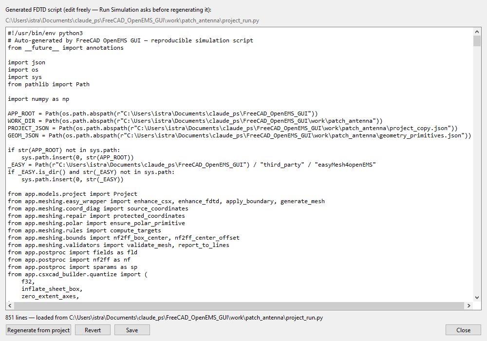

**Script editor.** Shows project_run.py — the script openEMS actually executes — with Save, Revert and Regenerate from project. Local edits are backed up as project_run_edited.py before a regeneration.

### 6.1 Mesh and simulation diagnostics

Two reports answer "is this run trustworthy?" — before and after the solver ran:

* **Mesh ➤ Mesh Timing / Feasibility…** (the same content appears right after
  *Build Mesh* in the **Mesh Report** tab and as one log line per build): the
  smallest cell per axis and the resulting `dt` (vacuum Courant limit plus the
  lower bound inside the densest dielectric), cells per wavelength at `f_max`,
  the runtime penalty of an over-refined cell against a typical one, the
  timesteps needed to cross the domain, and the frequency resolution
  `1/(max_timesteps·dt)` versus the requested sweep step. Every warning names
  the concrete remedy (e.g. "raise max_timesteps to >= 389000", or which cell is
  too coarse).
* **Simulation ➤ Simulation Status…** (after every run, successful or not; the
  same block is appended to the end of the log): errors and warnings from the
  solver log — including the mesh validation from before the run —, convergence
  (end criteria reached or max timesteps hit), the engine's exact facts
  (`dt`, Nyquist rate, excitation length, operator/field size,
  steps/energy/speed), the mesh estimate cross-checked against the engine value,
  the actual DFT window resolution, and the passivity of the S-parameters
  (`|S11|²+|S21|² ≤ 1`) versus frequency — separated into the core band and the
  sweep edge (a violation at the edge only is a DFT window artefact and
  harmless). It ends in a verdict (`OK` / `WARNING` / `ERROR`) with a trust
  rating ("reliable / use with care / unusable").

### 6.2 Mesh viewer


**Mesh viewer, XY slice at z = 1.6 mm.** The grid appears as lines, the geometry as areas: 75 mm board (blue), patch with its two staircase chamfers (orange), port (red), NF2FF box (violet dashed) and the FDTD domain (black dashed). You can see the cells refine over the patch and coarsen towards the maximum allowed cell size. The slider next to "Plane" moves the cut, "Mesh grid" toggles the lines, "Cell sizes" colours the cell sizes, "Overview" shows the 3D view. Right-clicking a marked cell opens the repair actions from section 6.1.

---

## 7. Evaluation

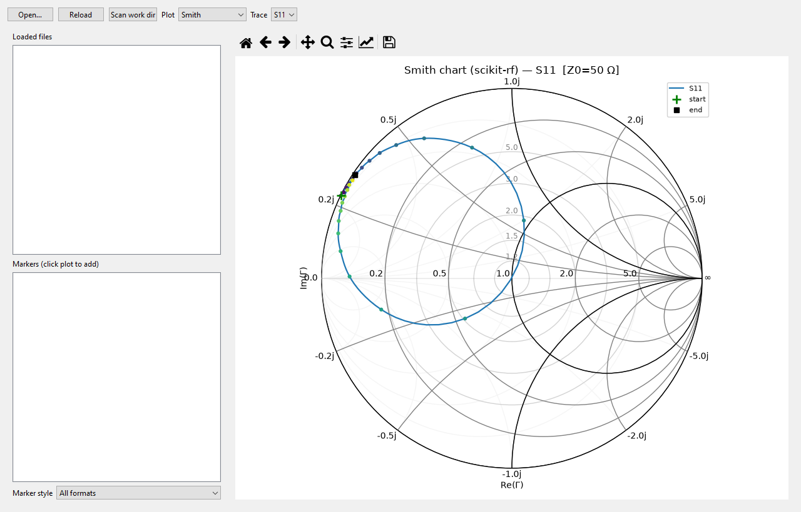

**S-parameters.** Smith chart, |S| dB, phase, VSWR; click markers, "Go to S-min" jumps to the resonance dip, "Pop out" detaches the plot into its own window.


1. **S-Params Viewer**
   - S11 / S21, dB, phase
   - Marker: frequency, S, Γ, Z/Y, VSWR, RL
   - Smith chart: Z and Y markers
2. **Pop-out S-Graph** — plot in a separate window
3. **Antenna** tab / **Simulation → Antenna Pattern Viewer** — NF2FF far field:
   3D polar gain plot, 2D polar cuts (E/H plane), directivity/gain/η vs
   frequency; **Pop-out Antenna Graph** = separate window; field dumps remain
   under `work/<project>/fields/` (S-parameters in
   `work/<project>/sparams/`, NF2FF in `work/<project>/nf2ff/`).
   **Polarization…** (button in the Antenna tab) shows quantities derived from
   the same NF2FF result — no new run: **axial ratio** (dB, RHCP/LHCP sense,
   tilt; linear → "linear") and **phase center** (Δx/Δy/Δz in mm plus the RMS
   of the phase fit) relative to the NF2FF box centre. The phase center is an
   estimate for a well-defined main beam; a fit that does not qualify shows
   "—" / "phase not well-defined". Details: F1 → "Polarization & Phase Center".
4. **2-port (S2P)** — one FDTD run measures **one** column of the S-matrix (for 2 ports:
   S11 + S21). Further columns need further runs with the other excited port
   (`excite_port` switched); the JSON results are merged afterwards —
   example: `examples\run_pcb_filter_example.py`.
   Unmeasured entries stay empty (NaN) in `sparams.json`; the Touchstone file
   (`.s2p`) is only written once the matrix is complete.
5. **Field Viewer** — 3D view of the field dumps (F1 for the in-app help). The
   vector arrows ("Vectors") **replace** the coloured field representation
   (ParaView style), so no opaque slice/surface covers the arrows that point
   into it; tick "field underneath" to get the overlay back. While stepping
   through a series by hand, the step label reports how many arrows flipped
   compared to the previous step — that makes it obvious whether the arrows
   really follow the field. With "same length" switched off the arrow length
   shows the amplitude; the reference is measured once over the whole series,
   so the lengths are comparable from frame to frame.
   The export writes a ParaView collection (`<dump>.pvd`) next to the per-step
   files, so the whole series can be played in ParaView from one file — see §12.4.

### 7.1 The Antenna tab in pictures


**Antenna tab, H-plane.** On the left the discovered NF2FF results and the details block (Dmax, Gmax, η, Prad, grid), on the right the polar cut with its dBi rings. Right-clicking the plot opens the analysis menu (HPBW, front-to-back ratio, markers, pop-out). Example: the 2.45 GHz patch from section 2.2.


**Plot type "Axial Ratio (theta cut)".** AR against θ at a selectable azimuth ("AR φ" selector in the plot toolbar, 0…315°). The green band is AR ≤ 3 dB; the dotted line and its label give the widest angle from boresight that still meets it. Example: GPS L1 patch at 1.57542 GHz — 1.70 dB at θ = 0°, ≤ 3 dB out to θ = 62°. The linearly polarised 2.45 GHz example stays above 10 dB everywhere, so there the cut is only a check.


**3D pattern.** The three spatial directions are labelled x/y/z. The radius is normalised to the dBi window ("dBi min" slider in the toolbar); the colour bar carries the absolute values.

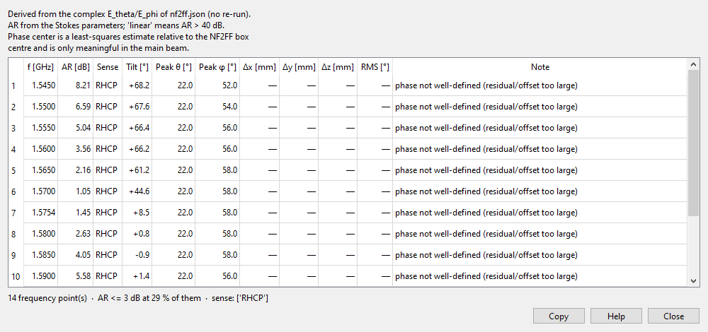

**"Polarization…" dialog.** One row per frequency with the AR at the pattern peak, the sense, tilt, peak direction and the phase center (Δx/Δy/Δz, RMS). The header line gives the number of points, the fraction with AR ≤ 3 dB and the senses present. "phase not well-defined" means the phase fit is not reliable for this pattern.

### 7.2 Field picture


**|Et| in the substrate, a slice from the field dump Et_substrate (2.45 GHz example).** Two maxima left and right of the centre, with the mode null between them. The axes are in metres, the colour bar in V/m. The post-processing writes such slices as PNG next to the dump (`work/<project>/fields/`). The interactive view is the **Field Viewer** tab: slices and iso-surfaces, vector glyphs ("Vectors") for the field direction, series playback over the time or frequency steps, and export as a VTK series including the ParaView collection (`<dump>.pvd`) and as MP4.

---

## 8. Workflow checklist (2.45 GHz antenna)

- [ ] FreeCAD: `gnd`, `substrate`, `patch` in mm
- [ ] Ports in FreeCAD: `PORT_in1_start` / `PORT_in1_stop` (optional, recommended)
- [ ] Export: `.step` (or `.fcstd` with ports)
- [ ] GUI: **New Project**
- [ ] Mesh: 2.2–2.7 GHz, target 2.45e9, unit mm
- [ ] **Import Geometry…** → STEP / FCStd
- [ ] **Add Assignment…** substrate (dielectric) + copper
- [ ] **Add Port…** lumped 50 Ω at the feed (or check the FreeCAD ports)
- [ ] **Fit NF2FF to Geometry** + enabled
- [ ] **Save…**
- [ ] **Build Mesh** → **Run Simulation**
- [ ] **S-Params Viewer** → S11 minimum near 2.45 GHz

---

## 9. Common problems

| Problem | Cause / fix |
|---------|-------------|
| Import does nothing for STEP | Check the FreeCADCmd path in Settings |
| Port missing or wrong | start/stop not on the edge of the patch |
| S11 bad | feed position, patch dimensions, mesh too coarse, max_timesteps too low |
| Material wrong | assignment missing; default is copper/PEC |
| FreeCAD does not start | Settings **FreeCAD GUI** (`FreeCAD.exe` next to `FreeCADCmd`) |
| Export without STL | export in FreeCAD / FreeCAD… → Export CAD… |
| Simulation aborts / empty S-params | check mesh/port; log path `work\<project>\` |
| `[ERROR] port_alignment … is not on a mesh line` | The port coordinate was not on a grid line (e.g. placed by a port-mode click). The GUI now puts the port coordinates on the grid itself (nearby interpolated lines are moved — see "port alignment: …" in the mesh log); only right next to a metal edge an offset < 15 % of a cell remains (warning `port_snapped`). Run **Build Mesh** again after updating. |
| `AssertionError` in `openEMS.Run` | `project_run.py` has relative paths (`WORK_DIR=…`) → regenerate the script (paths are saved absolute) |
| Warning `outside the field domain` | dump/NF2FF box too small → **Fit NF2FF to Geometry**; the script warns and clamps the box into the FDTD domain |
| Domain (black frame) too large/small | **Air margin** in Sim Params → Boundary conditions (auto = λ/4 at the stop frequency, otherwise an mm value for all faces) → then **Build Mesh** + **Fit NF2FF** (see 5.6) |
| S11 flat at ≈ 0 dB, Prad ≈ 0 | port short-circuited — for the Yagi that is the boom: the preset sets `gfrp` (dielectric, assignment `boom`), not `copper` |
| Own script “gone” after the run | `project_run.py` is regenerated on every run — your version is in `project_run_edited.py`; the GUI asks first (regenerate or run the script as-is) |
| 2-port missing S12/S22 | one run = one column → second run with the other `excite_port`, then merge (`examples\run_pcb_filter_example.py`) |

---

## 10. Tips

- **Preset first:** test the Patch/Yagi preset, then import your own FreeCAD geometry.
- **Clear object names** in FreeCAD (`patch`, `gnd`, `via`) — they appear as primitive names.
- **STEP import:** tessellation deflection ~0.1 mm; choose smaller for fine pins.
- **FreeCAD export helper (CLI):**  
  `examples\freecad_export_for_openems.py` (FreeCADCmd with `FREECAD_SOURCE` / `FREECAD_OUT_DIR`)
- Re-run **Build Mesh** after a material change.
- **Make script changes via "Script…"** — then the next run automatically backs up
  your version to `project_run_edited.py` and asks whether to regenerate or
  run it as-is.
- **2-port example (filter):** `Preset: PCB Filter…` in the GUI or
  `examples\run_pcb_filter_example.py` - both S-matrix columns, ready `sparams.s2p`.
- **2-port example (5.6 GHz band-pass):** `Preset: PCB Bandpass (5.6 GHz)…` or
  `examples\run_pcb_bandpass_example.py` - five open lambda/2 stubs on Teflon,
  |S11| < -10 dB from 4.90-6.45 GHz, ready `sparams.s2p`.
- **2-port example (2.4 GHz hairpin band-pass):** `Preset: PCB Hairpin Bandpass
  (2.4 GHz)…` or `examples\run_pcb_hairpin_example.py` - five folded lambda/2
  resonators on RT/duroid 6010 (eps_r 10.2, 1.27 mm), compact (~25 mm long),
  no vias, ready `sparams.s2p`.

---

## 11. Paths & tools (reference)

| Purpose | Path |
|---------|------|
| Start GUI | `app\main.py` |
| FreeCADCmd | `c:\FreeCAD_1.1.4-Windows-x86_64\bin\FreeCADCmd.exe` |
| FreeCAD GUI | `c:\FreeCAD_1.1.4-Windows-x86_64\bin\FreeCAD.exe` |
| openEMS | `c:\openEMS` |
| Work directory | `work\` |
| Export script | `examples\freecad_export_for_openems.py` |
| Port marker demo | `examples\freecad_add_port_marks.py` |
| Dipole + ports | `examples\freecad_dipole_ports.py`, `examples\run_dipole_ports_example.py` |
| FreeCAD port guide | `docs\FREECAD_PORTS_EN.md` |
| Yagi example | `examples\freecad_yagi_model.py`, `work\yagi_antenna\` |
| Smoke tests | `tests\freecad_gui_smoke.py`, `tests\freecad_mesh_smoke.py`, `tests\port_marks_smoke.py`, `tests\dipole_ports_smoke.py` |

---

## 12. Export & interchange (CAD, CST, ParaView)

Four output paths are meant for data exchange: **STEP** (geometry), **grid JSON**
(mesh lines), **Touchstone** (S-parameters) and **VTK** (field data). Another
solver such as CST Studio Suite reads the first three directly; VTK is the
neutral format for fields.

### 12.1 STEP — geometry to CAD / CST

**File → Export STEP…**

- What is exported is the *effective* geometry, i.e. exactly the primitives the
  simulation script is built from: analytic boxes, cylinders, spheres and
  extruded polygons plus every imported triangle mesh. Imported STEP/FCStd
  arrives **tessellated** (not as the original BREP) — the export shows what
  openEMS actually computes.
- Output: **AP214 STEP in millimetres**. The drawing unit from *Mesh → Drawing
  unit* is converted, so there is no unit guessing on the receiving side.
- **Object names are preserved**: every solid arrives in CST under the name it
  has in the Mesh Viewer / project tree (STEP `PRODUCT`).
- A **zero-thickness metal sheet** (e.g. the `patch` of the patch preset) is
  written as a **planar face**, not as a degenerate solid — openEMS only inflates
  it to 2 nm after meshing, which is useless as CAD.
- **Closed meshes** become solids, **open shells** stay shells. Both are valid
  STEP and either can be assigned a material in CST.
- Geometry that cannot be represented (a point, a line, a missing mesh) is
  reported in the log and skipped; the rest of the file is still written.
- Requires **FreeCADCmd** (as does STEP import), path under *Settings*.

> The FreeCAD dialog's “Export CAD…” is the **opposite direction** (FCStd/STEP →
> per-object STL + `openems_export.json` for the importer), not a geometry
> export.

### 12.2 Grid JSON — identical cells in CST

**Mesh → Export grid (JSON)…**

Both openEMS and the CST time-domain solver run on a rectilinear (hexahedral)
grid. Feeding CST the same line positions (e.g. via `Mesh.SetLines`) makes both
run on **identical cells** instead of two independently meshed models — which is
exactly where the two solvers would otherwise disagree.

- The source is the Mesh Viewer's CSX, i.e. the grid that was actually built (no
  re-derived estimate). Run “Build Mesh” first.
- Everything in **mm**, plus cell count, min/max cell size and the FDTD domain.
  Cylindrical meshes export `rho/phi/z`.

```json
{
  "format": "visualopenems-grid", "version": 1,
  "unit": "mm", "source_unit": "mm", "coord_system": "cartesian",
  "axes": [
    {"name": "x", "lines": [0.0, 0.5, 1.0, 2.0],
     "cells": 3, "cell_size_min": 0.5, "cell_size_max": 1.0}
  ],
  "shape": [3, 2, 2],
  "domain": {"start": [0, 0, 0], "stop": [2, 3, 1.6]}
}
```

### 12.3 CSX XML

**Mesh → Export CSX XML…** / **Open in AppCSXCAD (3D)…**

Writes the full CSXCAD model (geometry + grid, no field data) for AppCSXCAD or
ParaView — useful for review and for handing the model over.

### 12.4 Field data — VTK, `.pvd`, MP4

**Simulation → Export field dumps to VTK…**

- One static `<dump>.vtr` per dump and — for time series — one
  `<dump>_0000.vtr` … per stored step plus `<dump>.series.json` (labels, files,
  times/frequencies, stride) for the built-in viewer.
- Additionally a **ParaView collection `<dump>.pvd`**: open it in ParaView and
  the whole series plays from a *single* file. The slider value is the
  **physical** step position (time for TD dumps, frequency for FD dumps), not the
  step index. The `.pvd` is rebuilt from the sidecar whenever an up-to-date
  series is reused, so older exports become complete too.
- **Incremental**: outputs newer than their dump are reused, so a second click
  finishes instantly. The per-step switch writes the series (many files);
  `step_stride` keeps only every N-th step.
- Point data: scalar `magnitude` (active) and, for xyz dumps, the vector `field`
  (real part), in raw openEMS SI units (E in V/m …).

**Simulation → Export field video (MP4)…** renders the loaded series with the
current Field Viewer view (fps from *Settings*).

### 12.5 Network data — Touchstone

The S-Params viewer writes **Touchstone** (`.s1p`, `.s2p`, …) — the standard both
CST and openEMS read. One FDTD run measures **one** column of the S-matrix; the
Touchstone file is only written once the matrix is complete (partial matrices
stay in `sparams.json`). A 2-port therefore needs both excitations (switch
`excite_port`, results are merged).

### 12.6 Images

Every viewer (S-Params, Antenna, Field Viewer) exports **PNG**.

### 12.7 Overview

| Data | Format | Direction | Consumer |
|---|---|---|---|
| Geometry | STEP (mm) | out | CAD, CST, FreeCAD |
| Grid lines | grid JSON (mm) | out | CST FDTD (Mesh.SetLines) |
| S-parameters | Touchstone `.sNp` | out / in | CST, VNA, scikit-rf |
| E/H field volumes | VTK `.vtr` + `.pvd` | out | ParaView |
| Full model (CSX) | CSX XML | out | AppCSXCAD |

### 12.8 Limits

- **STEP carries geometry only** — no materials, ports or boundaries. Assign
  them in CST using the preserved object names.
- **No field-data import**: openEMS dumps are HDF5; CST exports its own formats.
  Compare solvers via S-parameters / far fields or via VTK in ParaView.
- Units are converted to **mm** on export (STEP and grid JSON); Touchstone stays
  in Hz. The source unit is the drawing unit from *Mesh*.
