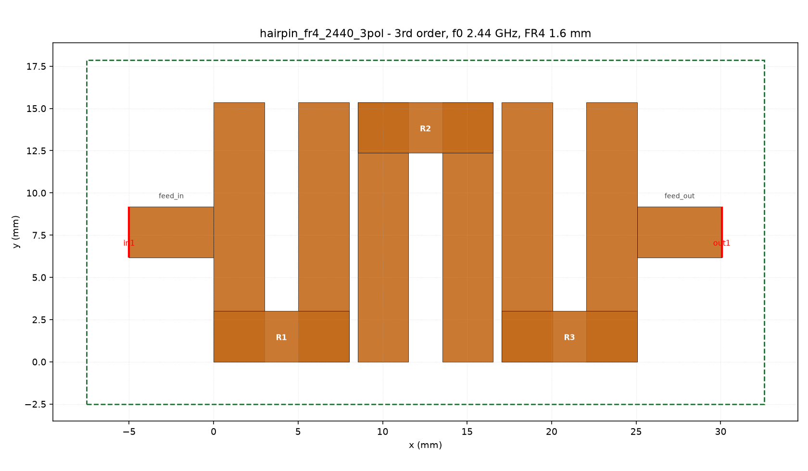
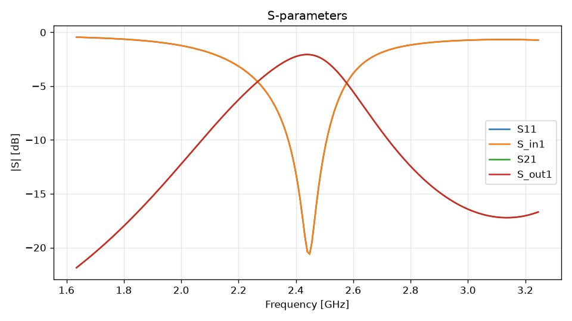

# Hairpin-Bandpass 2440 MHz, 3. Ordnung auf FR4

Beispielprojekt zu dem Filter-Design aus

> James Horton, **“Designing PCB Filters using MATLAB”** (Dez. 2021)
> https://www.jjhorton.co.uk/posts/matlabpcbfilters/

Der Artikel baut mit der MATLAB *RF PCB Toolbox* einen Hairpin-Bandpass für
das 2,4-GHz-ISM-Band und vergleicht Simulation und NanoVNA-Messung. Dieses
Projekt bildet dasselbe Design als openEMS/CSXCAD-Modell ab — mit den
Layout-Regeln des MATLAB-Objekts `filterHairpin`, damit die Platine wie auf
den Fotos im Artikel aussieht:

- drei U-förmige (Hairpin-)Resonatoren mit **abwechselnder Faltung**
  (unten / oben / unten) — das ergibt das meanderartige Leiterbild der
  Artikelplatinen,
- **einheitlicher Spalt** zwischen den Resonatoren (MATLAB-`Spacing`,
  0,5 mm — die `design`-Funktion setzt diesen „praktischen“ Wert),
- **getappte Einspeisung** (`FeedType = "Tapped"`, MATLAB-Standard): eine
  50-Ω-Leitung von der Platinenkante, die *auf* dem äußeren Arm endet,
- Armlänge = λg/4 aus dem ungeradzahligen εeff des Arm-Paares, Faltung
  ergänzt zum elektrischen λg/2.

| | |
|---|---|
| Projektdatei | `work/hairpin_fr4_2440_3pol/hairpin_fr4_2440_3pol.fcsim.json` |
| Erzeuger | `examples/run_pcb_hairpin_3pol_example.py` |
| Layout-Bild | `docs/images/hairpin_3pol_fr4_layout.png` |
| Kurzfassung | `work/hairpin_fr4_2440_3pol/README.md` |

---

## 1. Designziel

Das MATLAB-Skript des Artikels legt fest:

```matlab
N = 3; Ripple = 0.1; BandWidth = 10; Z0 = 50;
f = linspace(1500e6, 3000e6, 601);
EpsilonR = 4.5; Height = 1.6e-3;
d = dielectric("FR4"); d.EpsilonR = EpsilonR;
m = metal("Copper");

filter = filterHairpin();
filter.FilterOrder = N;
filter.Substrate = d;
filter.Conductor = m;
filter.Height = Height;
filter = design(filter, 2440e6, 'FBW', BandWidth, 'RippleFactor', Ripple);
```

Daraus folgt für dieses Projekt:

| Parameter | Wert |
|---|---|
| Filtertyp | Hairpin-Bandpass, drei gefaltete λ/2-Resonatoren |
| Ordnung / Welligkeit | 3 / 0,1 dB Chebyshev |
| Mittenfrequenz f0 | 2440 MHz |
| Bandbreite | 10 % → 2318 … 2562 MHz |
| Substrat | FR4, εr = 4,5, tan δ = 0,02, h = 1,6 mm, 35 µm Kupfer |
| Systemimpedanz | 50 Ω |
| Metallisierung | einlagig, kein Via, keine Stichleitung |

> **80 MHz oder 10 %?** Der Fließtext des Artikels nennt ein 80-MHz-Band, der
> veröffentlichte Code arbeitet aber mit `BandWidth = 10`, also 10 % ≈ 244 MHz.
> Dieses Projekt folgt dem Code. Für 80 MHz genügt `FBW = 80/2440 ≈ 0,0328`
> im Erzeugerskript — die Armlänge bleibt dabei gleich, nur die Kopplung ändert
> sich.

---

## 2. Abmessungen und Synthese

### Armlänge

Der Hairpin ist ein gefalteter λ/2-Resonator: zwei Arme plus Faltung ergeben
λg/2. Die beiden Arme eines Hairpins tragen Gegenströme, der Resonator
schwingt also im **ungeradzahligen Modus** des Arm-Paares. Die Armlänge folgt
deshalb dem εeff,odd des Paares (Innenabstand 2 mm), nicht dem εeff einer
Einzelleitung — mit dem Einzelleiter-εeff wären die Arme ca. 15 % zu kurz.

```
w50  = msl_u_for_z0(50 Ω, εr 4,5) · h          = 3,011 mm
εeff,odd(w50, 2,0 mm)                          = 3,112
λg   = c0 / (f0 · sqrt(εeff,odd))              = 69,65 mm
Arm  = (λg/2 − (w50 + Innenabstand)) / 2       = 14,907 mm
Arm  (FDTD-kalibriert, ARM_SCALE 1,031)        = 15,369 mm
```

Der Faktor 1,031 ist **empirisch kalibriert**: ein einzelner Hairpin dieser
Geometrie (getappte 2-Port-Messung, gleiche Querschnitte) resoniert mit
14,907 mm bei 2,540 GHz und mit 15,369 mm bei 2,441 GHz. Das
Hammerstad-Jensen-λg ist für diesen Querschnitt also ~3 % zu kurz.

### Kopplung

MATLABs `design` setzt laut eigener Doku **0,5 mm Spannung zwischen allen
Resonatoren** („practical approach“); die Doku weist selbst darauf hin, dass
dieser Wert für eine genaue Response nachjustiert werden muss. Genau dieser
Wert erzeugt das Leiterbild der Artikelplatinen (gleich breite Spalte,
ca. 33 mm Platinenbreite).

Zum Vergleich, was ein sauber synthetisierter 3-Pol-Filter mit 10 %
Bandbreite bräuchte (J-Inverter der 0,1-dB-Chebyshev-Prototypparameter
`g1..g3 = 1,0316 / 1,1474 / 1,0316`, wie beim 5-Pol-App-Preset):

| Abschnitt | J/Y0 | Z0e / Z0o | nötiger Spalt | k |
|---|---|---|---|---|
| 1 (Feed → R1) | 0,390 | 77,1 / 38,1 Ω | 0,189 mm | 0,339 |
| 2 (R1 → R2) | 0,144 | 58,3 / 43,8 Ω | 1,357 mm | 0,141 |
| 3 (R2 → R3) | 0,144 | 58,3 / 43,8 Ω | 1,357 mm | 0,141 |
| 4 (R3 → Feed) | 0,390 | 77,1 / 38,1 Ω | 0,189 mm | 0,339 |

Der einheitliche 0,5-mm-Spalt ergibt dagegen k ≈ 0,250 — alle Abschnitte sind
**überkoppelt**, das Durchlassband wird breiter als 10 %. Das ist genau der
Effekt, den der Artikel an seinen gemessenen Filtern beschreibt („passband
pushed to a lower frequency, and a wider pass band“). Wer ein exaktes 10-%-Band
will, muss die Spalte nicht-uniform aus der Tabelle oben setzen (das macht das
5-Pol-App-Preset) oder `SPACING` im Erzeugerskript reduzieren und die Arme
nachziehen.

### Getappte Einspeisung

Die 50-Ω-Leitung (Breite w50) endet auf dem äußeren Arm. Die Tapposition
bestimmt die externe Güte Qe:

| Tap-Punkt (Anteil der Armlänge vom Faltungsende) | Qe (Näherung) | Folge |
|---|---|---|
| 0,50 (wie auf den Artikelplatinen, Standard hier) | ≈ 3 | stark überkoppelt |
| 0,75 | ≈ 10 | passend für 10 % Bandbreite |

`TAP_FRAC` im Skript ist der Stellhebel; 0,5 reproduziert die Fotos.

### Dimensionstabelle (mm)

| Größe | Wert |
|---|---|
| Streifenbreite w50 (Arme, Feeds) | 3,011 |
| Armlänge | 15,369 (kalibriert) |
| Innenabstand der U-Arme | 2,000 |
| Faltung (elektrische Länge) | 5,011 |
| Spalt zwischen Resonatoren | 0,500 |
| Tap-Höhe über Faltungsende | 7,684 |
| Feed-Länge (Rand → Arm) | 5,000 (Artikel: `PortLineLength = 0,006`) |
| Leiterbild-Spanne inkl. Feeds | 35,07 |
| Platine im Modell (x × y × z) | 40,07 × 20,37 × 1,6 |

---

## 3. Layout



Von links nach rechts: getappte Zuleitung `feed_in` (bei y = 7,68 mm, also
mittig auf dem Arm) — Hairpin R1 (Faltung unten) — 0,5 mm — R2 (Faltung oben)
— 0,5 mm — R3 (Faltung unten) — getappte Ableitung `feed_out`. Die Arme stehen
senkrecht (y), der Signalweg läuft waagerecht (x); die abwechselnde Faltung
erzeugt das Meander-Bild der Fotos.

Alle Metallteile liegen in der Ebene z = 1,6 mm (Kupferoberkante, nulldick).
Die Einspeisung ist **galvanisch** (T-Knoten am Arm), nicht kapazitiv über
einen parallelen Koppelabschnitt — das ist der wesentliche Unterschied zu
einem „coupled-input“-Hairpin.

---

## 4. Projektdatei

`.fcsim.json` (Version 1), erzeugt über die Dataclasses aus
`app/models/project.py`:

| Block | Inhalt |
|---|---|
| `materials` | `copper` (PEC), `fr4` (εr 4,5, tan δ 0,02, κ = tan δ·2πf0·ε0·εr ≈ 0,0122 S/m) |
| `primitives` | 13 Boxen: Masse, Substrat, 2 Feed-Leitungen, 3 × (Arm 1, Arm 2, Faltung) |
| `ports` | `in1` / `out1`, lumped, 50 Ω, Richtung z, Portebene an der Platinenkante (x = −5 bzw. 30,07) über die Feedbreite in y und die Substratdicke in z; `in1` erregt |
| `dumps` | `E_substrate`, E-Feld, z = h/3 = 0,533 mm (auf einer Gitterlinie), 2440 MHz |
| `nf2ff` | Box vorhanden, aber deaktiviert (Filter, keine Antenne) |
| `mesh` | Preset `high`, 20 Zellen/λ, f 1,635–3,245 GHz, `min_cellsize` = 0,5/3 = 0,167 mm, `min_cellsize_z` = h/3, `smooth_metal_edge = False`, `handle_closely_placed_edges = False`, manuelle Linien nur in x (Metallflächen) und z |
| `boundary` | MUR an allen Seiten außer `zmin = PEC` (Masse), Luftrand 20/20/20/20/0/25 mm |
| `sim` | `end_criteria = 1e-4`, `max_timesteps = 600 000`, Felddumps an, NF2FF aus |

Öffnen: **File → Open Project…** (Ctrl+O), dann **Mesh → Build Mesh** (Ctrl+M)
und **Simulation → Run All Ports** (Ctrl+Shift+R). Ein einzelner *Run* misst
nur eine S-Matrix-Spalte; *Run All Ports* fährt beide Erregungen und merged sie
zu `sparams/sparams.s2p`.

---

## 5. Reproduktion

```powershell
cd C:\Users\istra\Documents\claude_ps\FreeCAD_OpenEMS_GUI

# nur die Synthesetabelle
c:\Python\WPy64-31150\python-3.11.5.amd64\python.exe examples\run_pcb_hairpin_3pol_example.py --design

# Projekt + Laufskripte schreiben (ohne FDTD)
c:\Python\WPy64-31150\python-3.11.5.amd64\python.exe examples\run_pcb_hairpin_3pol_example.py --skip-run

# Gitter bauen und prüfen
c:\Python\WPy64-31150\python-3.11.5.amd64\python.exe examples\run_pcb_hairpin_3pol_example.py --mesh-only

# beide Erregungen rechnen und zur vollständigen S-Matrix mergen
c:\Python\WPy64-31150\python-3.11.5.amd64\python.exe examples\run_pcb_hairpin_3pol_example.py
```

Das Skript schreibt `work/hairpin_fr4_2440_3pol/` (Projekt, `project_run.py`,
`port2/` für die zweite Erregung) und beim vollen Lauf
`sparams/sparams.{json,s2p,png}`. Alle Designparameter stehen als Konstanten
am Dateikopf: `F0`, `FBW`, `EPS_R`, `TAND`, `H`, `INNER_GAP`, `SPACING`,
`TAP_FRAC`, `ARM_SCALE`.

---

## 6. Mesh

Das Gitter wird von easyMesh erzeugt. Das Projekt gibt nur Linien vor, die
easyMesh nicht selbst findet:

- **x:** exakt die x-Flächen aller Kupferboxen. Ohne diese Linien setzt
  easyMesh keine Gitterlinie auf die x-Flächen der nulldicken Kupferbahnen —
  die 0,5-mm-Spalte und die Feed-Enden würden vom groben Luftgitter
  „verschluckt“ (gemessen: Metallfläche bis 0,56 mm neben der nächsten Linie).
- **z:** −0,25 / 0 / h/3 / 2h/3 / h, also vier FR4-Schichten und eine
  Metallschicht für die Masse.
- **y:** keine manuellen Linien; easyMesh erkennt die y-Kanten selbst.
- **Kein Füllraster** zwischen den Flächen: zusätzliche Linien landeten neben
  den von easyMesh selbst erzeugten Linien und bildeten 5–40-µm-Zellen
  (Δt 0,017–0,13 ps statt 0,174 ps).

Ergebnis (Build Mesh, Projektzustand):

| Kennwert | Wert |
|---|---|
| Zellen (Build Mesh) | 149 × 95 × 14 = 198 170 (Laufskript: 216 000) |
| Zellweite x / y / z (min · typ · max) | 0,192 · 0,255 · 4,48 / 0,167 · 0,236 · 4,48 / 0,25 · 1,04 · 5,66 mm |
| Auflösung bei 3,245 GHz | 20,6 / 20,6 / 16,3 Zellen pro Wellenlänge (Soll ≥ 10) |
| Zeitschritt (openEMS-Lauf) | 0,1736 ps |
| Laufende durch Endkriterium 1e-4 | ≈ 31 000 Schritte ≈ 5,4 ns → DFT ≈ 185 MHz |
| DFT-Auflösung bei 600 000 Schritten (falls nicht vorher konvergiert) | ≈ 10 MHz |
| Kantentreue | alle Metallflächen ≤ 2 nm neben einer Gitterlinie; Dump-Ebene auf einer Linie |

Erwartete Warnungen im Mesh-Report:

| Meldung | Bedeutung |
|---|---|
| `grading_jump` y ≈ 4,5 | Übergang von den feinen Zellen am Feed/Tap zu den 0,2-mm-Zellen im Luftraum |
| `grading_jump` z ≈ 2,1 | Übergang 0,25 mm Masse-/Kupferschicht → 0,53 mm FR4 |
| `resolution_limited` | der voreingestellte S-Parameter-Sweep (8 MHz) ist feiner als das DFT-Fenster; für feinere Kurven `end_criteria` senken (z. B. 1e-6) und `max_timesteps` erhöhen |

---

## 7. Validierungsstand

Geprüft (headless, mit dem App-Python):

- Projekt-Round-Trip (`Project.load`), CSX-Aufbau, easyMesh und `csx.xml`
  laufen für beide Erregungen durch (`--mesh-only`, Exit-Code 0).
- Alle x-, y- und z-Metallflächen liegen auf Gitterlinien (≤ 2 nm), die
  Dump-Ebene ebenfalls; keine Mikrozellen im Gitter.
- **Einzelresonator kalibriert:** ein Hairpin dieser Geometrie mit getappter
  2-Port-Messung resoniert bei 2,540 GHz (Arm 14,907 mm) bzw. 2,441 GHz
  (Arm 15,369 mm, `ARM_SCALE = 1,031`) mit S21 ≈ −0,4 dB. Der Resonator liegt
  damit auf 2440 MHz; die Kalibrierung ist im Skript dokumentiert.
- **3-Pol-Probelauf (31 000 Schritte ≈ 5,4 ns, eine Erregung):** die drei
  Moden sind sichtbar gespreizt (S21 −2 dB bei 2,6–2,9 GHz, S11-Minimum
  −23 dB bei 2,95 GHz). Das ist die Folge der bewusst überkoppelten
  0,5-mm-Spalte (k ≈ 0,25) und des Taps bei 50 % — qualitativ dasselbe Bild
  wie die gemessenen Platinen im Artikel (breites, gewelltes Durchlassband).
  Wegen des kurzen DFT-Fensters (≈ 185 MHz) ist die Kurve noch grob.

**Nicht** validiert ist eine belastbare S-Kurve. Dafür `end_criteria` auf
z. B. 1e-6 senken (der Lauf stoppt sonst nach ~5 ns) und den vollen Lauf
starten; dann `sparams/sparams.png` bzw. den S-Parameter-Viewer prüfen.

---

## 8. Vergleich mit dem Artikel

| Punkt | Artikel (MATLAB) | Dieses Projekt |
|---|---|---|
| Werkzeug | RF PCB Toolbox `filterHairpin` + `sparameters` | openEMS/CSXCAD, FDTD |
| Resonatoren | 3 U-Resonatoren, abwechselnde Faltung | identisch |
| Kopplung | einheitlich 0,5 mm (`design`-Standard) | identisch |
| Einspeisung | getappt, 50-Ω-Leitung von der Kante auf den Außenarm | identisch (Tap bei 50 % der Armlänge) |
| Bandbreite | Code: 10 %, Text: 80 MHz | 10 % als Ziel; Layout überkoppelt (s. o.) |
| Substrat | FR4, εr 4,5, 1,6 mm | identisch, zusätzlich tan δ = 0,02 |
| Fertigung | Gerber-Export, Import in KiCad, SMA-Edge-Connectors | keine Gerber/Ausschnitte; Ports sind lumped 50 Ω an der Kante |
| Messung | NanoVNA: Durchlassband tiefer und breiter als simuliert | – |
| Ursache laut Artikel | εr von FR4 ist frequenzabhängig, bei 2,45 GHz real eher 4,2–4,3 | im Modell über `EPS_R` nachziehbar |

Für den Messabgleich also `EPS_R` reduzieren (z. B. 4,2) oder die
Resonanzlänge über `ARM_SCALE` trimmen (`> 1` verlängert die Arme und senkt
f0). Danach das Projekt neu erzeugen und laden.

---

## 9. Grenzen und offene Punkte

- Kein Leiterplattenumriss, keine Bohrlöcher, keine SMA-Footprints – das
  Modell ist rein elektromagnetisch (Massefläche = ganze Platine).
- Kupfer ist als nulldicke PEC-Fläche modelliert (kein 35-µm-Volumen).
- Ein Lauf misst eine S-Matrix-Spalte; die vollständige Matrix entsteht erst
  durch *Run All Ports* bzw. den Beispiel-Lauf mit beiden Erregungen.
- Das Layout ist nicht als fertigungsreifes Gerber gedacht. Wer es fertigen
  will, exportiert das Modell (Mesh → Export …) oder zeichnet es aus den in
  Abschnitt 2 genannten Maßen in KiCad nach.
- Die frühere Fassung dieses Projekts hatte eine kapazitiv gekoppelte,
  vollflächig parallele Einspeisung (wie das 5-Pol-App-Preset) und
  nicht-uniforme Spalte. Sie entspricht nicht den Fotos und wurde ersetzt;
  das 5-Pol-Preset (`examples/run_pcb_hairpin_example.py`) zeigt dieses
  Prinzip weiterhin.

---

## 10. Dateien

| Pfad | Rolle |
|---|---|
| `examples/run_pcb_hairpin_3pol_example.py` | Synthese, Projektaufbau, optionaler Lauf + Merge |
| `work/hairpin_fr4_2440_3pol/hairpin_fr4_2440_3pol.fcsim.json` | Projektdatei |
| `work/hairpin_fr4_2440_3pol/README.md` | Kurzfassung im Projektordner |
| `work/hairpin_fr4_2440_3pol/layout.png` | Layout-Draufsicht |
| `docs/images/hairpin_3pol_fr4_layout.png` | dieselbe Grafik für diese Doku |
| `app/csxcad_builder/hairpin.py` | gemeinsame Synthese-Helfer (auch für das 5-Pol-Preset) |
| `examples/run_pcb_hairpin_example.py` | analoges 5-Pol-Beispiel auf RT/duroid 6010 |

---

## 11. Optimierte Variante (performanter Filter)

Die artikelgetreue Fassung (einheitlich 0,5 mm, Tap bei 50 % der Armlänge) ist
stark überkoppelt: im FDTD liegen S21 bei 2,44 GHz nur bei −18 dB und S11 bei
−1 dB — der Filter sperrt praktisch im Zielband (siehe Abschnitt 5).

Für ein nutzbares Bauteil gibt es deshalb eine zweite, **optimierte Variante**
mit gleichem Aussehen (drei U-Resonatoren, abwechselnde Faltung, getappte
Feeds), aber mit den Kopplungen und der externen Güte der
0,1-dB-Chebyshev-Synthese:

| Parameter | artikelgetreu | **optimiert** |
|---|---|---|
| Spalt zwischen den Resonatoren | 0,500 mm | **0,700 mm** |
| Tap-Punkt (Anteil der Armlänge) | 50 % | **65 %** |
| Armlänge (FDTD-kalibriert) | 15,369 mm | **17,754 mm** |
| `ARM_SCALE` | 1,031 | 1,191 |
| Projekt | `hairpin_fr4_2440_3pol` | `hairpin_fr4_2440_3pol_opt` |

Die Werte sind FDTD-kalibriert (Kopplung und Tap laden den Resonator, deshalb
weicht die Armlänge von der reinen λg/4-Rechnung ab). Ergebnis eines
Einzel-Erregungslaufs (Port 1, Endkriterium 1e-6):

| Frequenz | S11 | S21 |
|---|---|---|
| 2,40 GHz | −13,0 dB | −2,25 dB |
| 2,44 GHz | **−20,4 dB** | **−2,06 dB** |
| 2,48 GHz | −14,2 dB | −2,30 dB |
| 2,52 GHz | −8,6 dB | −3,02 dB |
| 2,56 GHz | −5,5 dB | −4,16 dB |

Damit ist das ISM-Band (2,400–2,4835 GHz) durchgehend mit S11 besser als
−13 dB und etwa 2,1–2,3 dB Einfügedämpfung abgedeckt; die 3-dB-Bandbreite
liegt bei ca. 2,36–2,59 GHz (≈ 9 %). Die Einfügedämpfung ist auf 1,6 mm FR4
(tan δ = 0,02) plausibel — der Artikel misst an seinen Platinen ebenfalls
rund 2 dB.



Erzeugen und rechnen:

```powershell
# Projekt + Laufskripte der optimierten Variante
c:\Python\WPy64-31150\python-3.11.5.amd64\python.exe examples\run_pcb_hairpin_3pol_example.py --optimized --skip-run

# beide Erregungen rechnen und zur vollständigen S-Matrix mergen
c:\Python\WPy64-31150\python-3.11.5.amd64\python.exe examples\run_pcb_hairpin_3pol_example.py --optimized
```

| Pfad | Rolle |
|---|---|
| `work/hairpin_fr4_2440_3pol_opt/hairpin_fr4_2440_3pol_opt.fcsim.json` | optimiertes Projekt |
| `work/hairpin_fr4_2440_3pol_opt/sparams_sim.png` | S11/S21 des Einzel-Erregungslaufs |
| `work/hairpin_fr4_2440_3pol_opt/sparams_port1.json` | Rohdaten dazu (JSON) |

Grenzen: der gezeigte Lauf erregt nur Port 1 (S11/S21); die vollständige
2×2-Matrix entsteht mit *Run All Ports* bzw. dem vollen Beispiel-Lauf. Ein
noch breiteres Band braucht kleinere Spalte und einen tieferen Tap — dann
verschiebt sich die Mittenfrequenz und `ARM_SCALE` muss nachgezogen werden
(bei 0,5 mm Spalt wurde das Gitter so fein, dass der Lauf unverhältnismäßig
lange braucht).
