# Inverted-F Antenna on a PCB - 5.8 GHz tutorial

[Watch the MP4](IFA_5p8GHz_Tutorial.mp4)

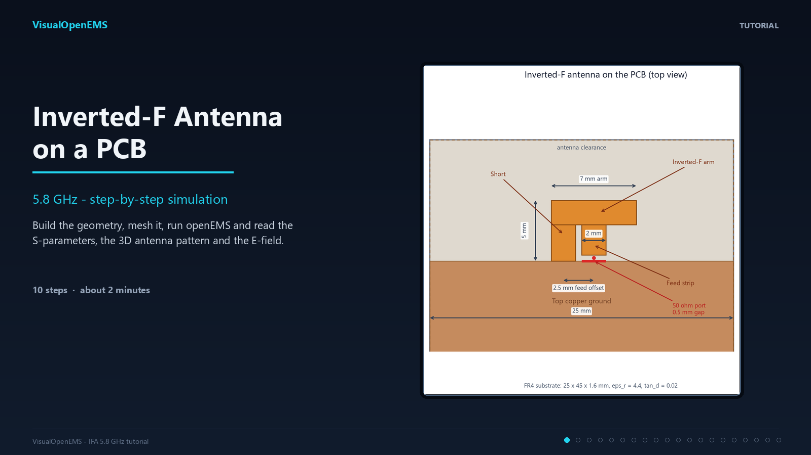

A detailed VisualOpenEMS walkthrough: build the PCB and the inverted-F
metal, add the port, mesh the model, run openEMS and read the
S-parameters, the 3D antenna pattern and the E-field. Every step names
the exact menu path or tab and shows a screenshot with the target
highlighted.

> The GUI screenshots are real. The S-parameter curve, pattern and
> field maps use representative IFA data so the viewers can be explained
> without a long FDTD run; your own results will differ with geometry,
> mesh and materials.

## What you need

- VisualOpenEMS with a working openEMS/CSXCAD installation.
- A work folder for the project and results.
- About 10 minutes for the build; the FDTD run takes a few minutes.

## GUI map

| Region | What it is for |
| --- | --- |
| Menu bar | File, Geometry, Mesh, Simulation, View, Settings, Help |
| Project / Geometry tree | Primitives, materials, ports, dumps, NF2FF box |
| Tabs | Geometry, Mesh Viewer, 3D Design, S-Params, Antenna, Field Viewer |
| Status bar | Timestep/energy progress, runtime, log toggle |

## Geometry

| Part | Dimensions / position |
| --- | --- |
| FR4 substrate | 25 x 45 x 1.6 mm, eps_r = 4.4, tan_d = 0.02 |
| Bottom ground | 25 x 45 mm, z = 0...0.035 mm |
| Top ground | 25 x 35 mm, z = 1.6...1.635 mm |
| IFA arm | 7 x 2 mm, y = 38...40 mm, z = 1.6...1.635 mm |
| Short | 2 x 5 mm, x = 10...12 mm, y = 35...40 mm |
| Feed strip | 2 x 2.5 mm, x = 12.5...14.5 mm, y = 35.5...38 mm |
| Port | lumped, 50 ohm, direction y across the 0.5 mm gap, width x = 2 mm |
| Mesh | max 1.2 mm, min 0.15 mm, 18 cells/lambda at 5.8 GHz |

## Video chapters

| Time | Chapter |
| --- | --- |
| 00:00 | Title and overview |
| 00:04 | Step 1 - The main window |
| 00:09 | Step 2 - Start a new project |
| 00:13 | Step 3 - Set the frequency range |
| 00:18 | Step 4 - Create the FR4 material |
| 00:22 | Step 5 - Add the PCB substrate |
| 00:27 | Step 6 - Add the ground planes |
| 00:31 | Step 7 - Add the IFA arm |
| 00:36 | Step 8 - Add the short and the feed |
| 00:40 | Step 9 - Add the 50 ohm feed port |
| 00:45 | Step 10 - Add the E-field dump |
| 00:50 | Step 11 - Enable the NF2FF far field |
| 00:54 | Step 12 - Set the mesh parameters |
| 00:59 | Step 13 - Build the mesh |
| 01:03 | Step 14 - Check the mesh quality |
| 01:08 | Step 15 - Run the FDTD simulation |
| 01:12 | Step 16 - Read the S-parameters |
| 01:17 | Step 17 - Read the antenna pattern |
| 01:21 | Step 18 - Inspect the E-field |
| 01:26 | Summary and tuning tips |

## Steps

### Step 1 - The main window

**Where:** the window that opens when VisualOpenEMS starts

**Do:**

- Menu bar: **File**, **Presets**, **Geometry**, **Mesh**, **Simulation**, **View**, **Settings**, **Help**.
- Left panel **Project / Geometry**: every primitive, material, port, dump and NF2FF box.
- Tabs: **Geometry**, **Mesh Viewer**, **3D Design**, **S-Params**, **Antenna**, **Field Viewer**.
- Bottom bar: run status, timestep/energy bars, runtime and the log toggle.

**Check:** The project tree and the tabs are the two places you will use most.

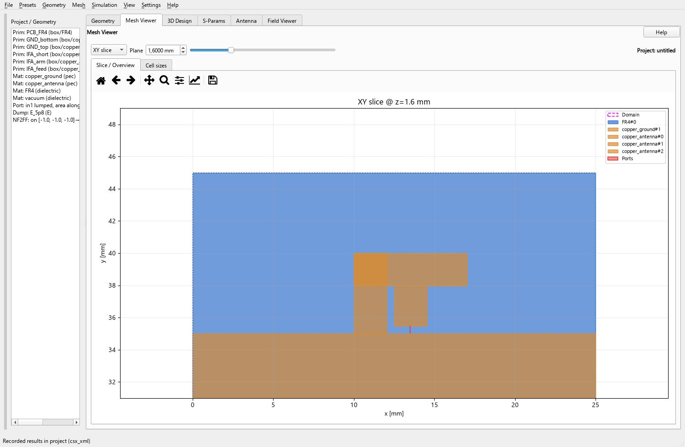

### Step 2 - Start a new project

**Where:** **File -> New Project** (Ctrl+N)

**Do:**

- Choose a work folder under **Settings -> Settings...** if you want the results somewhere specific.
- Save the project with **File -> Save** (Ctrl+S); it stores geometry, mesh, ports and results in one `.fcsim.json` file.

**Check:** The window title shows the project name; the tree is empty except for defaults.

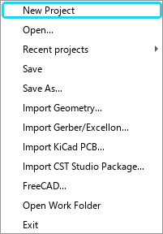

### Step 3 - Set the frequency range

**Where:** **Simulation -> Simulation Parameters...** (Ctrl+Shift+P), tab **Simulation-Parameter**

**Do:**

- Drawing unit: **mm**.
- Start frequency **5.0 GHz**, stop frequency **6.6 GHz**, target frequency **5.8 GHz**.
- Boundary conditions: PML on all sides, **zmin = PEC** (the ground plane sits there).
- Press **Apply**; the computed block shows max cell 1.2 mm and the air margin.

**Check:** The computed block lists 5.0 / 6.6 / 5.8 GHz and max cell lambda/10 = 1.2 mm.

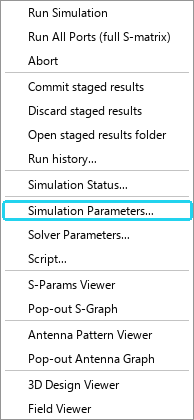

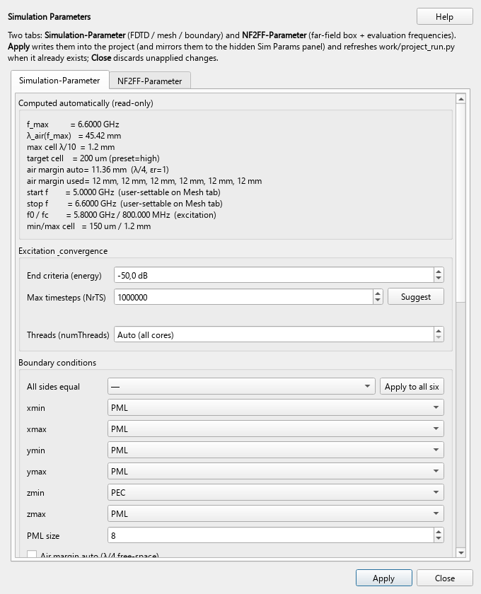

### Step 4 - Create the FR4 material

**Where:** **Geometry -> Add Material...**

**Do:**

- Name **FR4**, kind **dielectric**.
- eps_r = **4.4**, kappa = 0, tan_d = **0.02**.
- Press **OK**; the material appears under Materials in the project tree.

**Check:** The material row shows FR4 (dielectric) with eps_r 4.4.

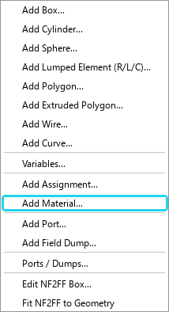

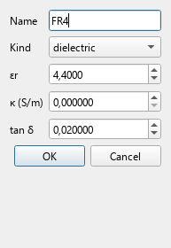

### Step 5 - Add the PCB substrate

**Where:** **Geometry -> Add Box...**

**Do:**

- Name **PCB_FR4**, material **FR4**, priority **1**.
- Start **0 / 0 / 0 mm**, stop **25 / 45 / 1.6 mm**.
- This is the 1.6 mm board; the low priority keeps the copper on top.

**Check:** The tree shows Prim: PCB_FR4 and the mesh viewer draws a blue substrate.

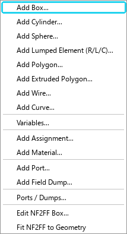

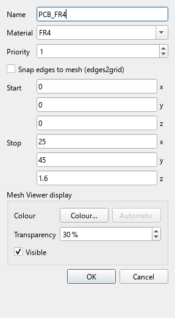

### Step 6 - Add the ground planes

**Where:** **Geometry -> Add Box...** (twice), or duplicate the box with Ctrl+D

**Do:**

- Bottom ground: **0 / 0 / 0** to **25 / 45 / 0.035 mm**, copper, priority 10.
- Top ground: **0 / 0 / 1.6** to **25 / 35 / 1.635 mm**, copper, priority 10.
- The top ground stops at y = 35 mm, leaving a **10 mm antenna clearance**.

**Check:** In the XY slice at z = 1.6 mm the copper covers y = 0...35 only.

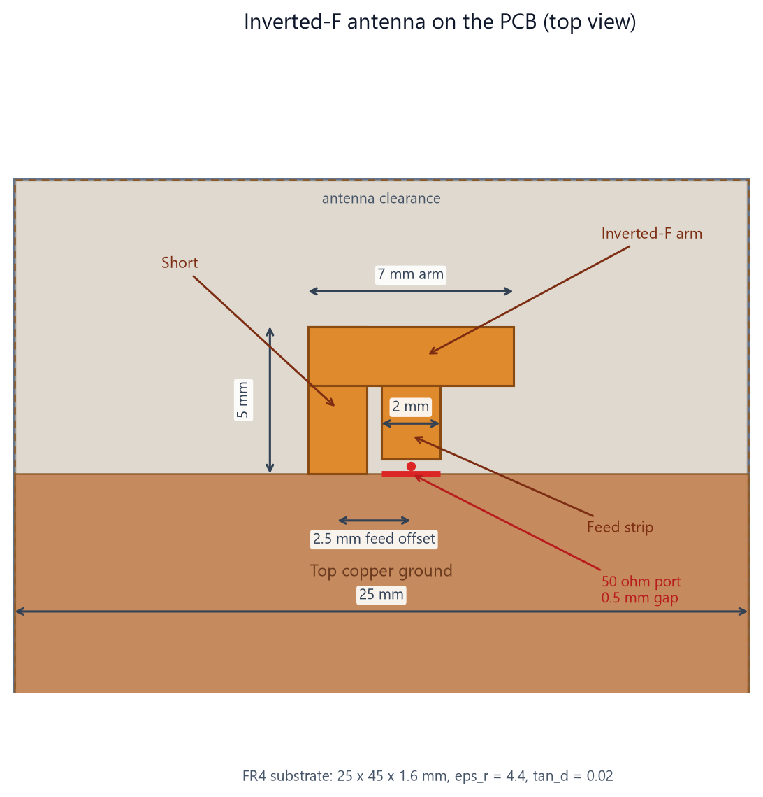

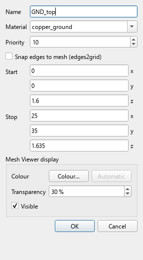

### Step 7 - Add the IFA arm

**Where:** **Geometry -> Add Box...**

**Do:**

- Name **IFA_arm**, material **copper_antenna** (or copper), priority 10.
- Start **10 / 38 / 1.6 mm**, stop **17 / 40 / 1.635 mm**.
- The arm is 7 x 2 mm and sits on top of the substrate.

**Check:** The top view shows the horizontal arm at the ground edge.


### Step 8 - Add the short and the feed

**Where:** **Geometry -> Add Box...** (two more boxes)

**Do:**

- Short: **10 / 35 / 1.6** to **12 / 40 / 1.635 mm**.
- Feed: **12.5 / 35.5 / 1.6** to **14.5 / 38 / 1.635 mm**.
- Leave a **0.5 mm gap** between the feed (y = 35.5) and the top ground (y = 35.0).

**Check:** The three copper boxes form the F shape; the gap is clearly visible.


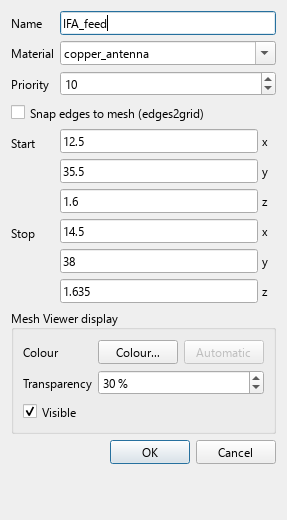

### Step 9 - Add the 50 ohm feed port

**Where:** **Geometry -> Add Port...** (also in the Ports / Dumps window, Ctrl+Shift+D)

**Do:**

- Type **lumped**, resistance **50 ohm**, direction **y**.
- Width (lumped): **Area - as wide as the metal (x)**.
- Start **13.5 / 35.5 / 1.6 mm**, stop **13.5 / 35.0 / 1.6 mm**.
- The metal reference is **IFA_feed**; the port list shows `area along X`.

**Check:** The port spans the 0.5 mm gap and is as wide as the 2 mm feed strip.

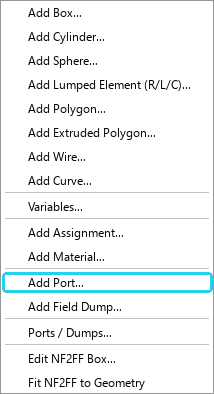

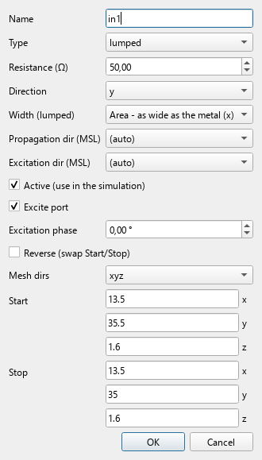

### Step 10 - Add the E-field dump

**Where:** **Geometry -> Add Field Dump...**

**Do:**

- Name **E_5p8**, quantity **E**, frequency **5.8 GHz**, file type **VTK (.vtr)**.
- Box: **-5 / 28 / -3** to **30 / 47 / 14 mm**; optional resolution 0.2 mm.
- Enable **Frequency domain** and **Enabled**.

**Check:** The tree lists Dump: E_5p8 (E); the Field Viewer will read the .vtr file.

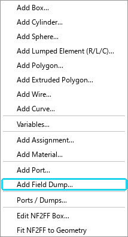

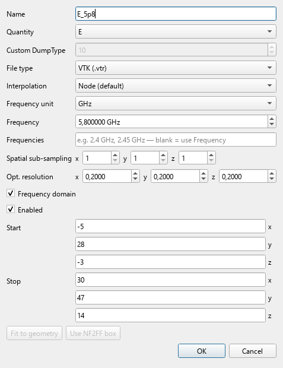

### Step 11 - Enable the NF2FF far field

**Where:** **Simulation -> Simulation Parameters...** -> tab **NF2FF-Parameter**

**Do:**

- Tick **Enable far-field (NF2FF)**.
- Mode **Frequency list**, frequencies **5.8 GHz**.
- Box placement **Automatic (fit to geometry + air margin)**.
- theta steps **181**, phi steps **361**.

**Check:** The tree shows NF2FF: on; the antenna pattern will be evaluated at 5.8 GHz.


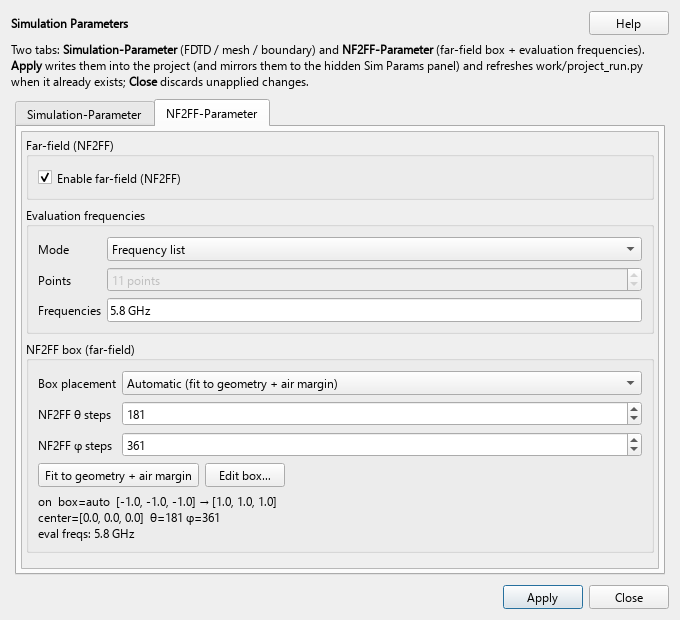

### Step 12 - Set the mesh parameters

**Where:** **Mesh -> Mesh Parameters...** (Ctrl+Shift+M)

**Do:**

- Max cell **1.2 mm**, min cell **0.15 mm**, min z cell **0.08 mm**.
- Refined cell **0.2 mm**, max grading ratio **2.0**.
- Cells per wavelength **18**; mesh directions **xyz**.
- Press **Apply** to write the values into the project.

**Check:** The dialog shows the values above; the mesh report will quote them.

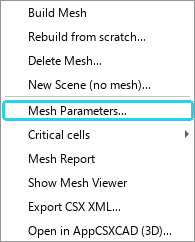

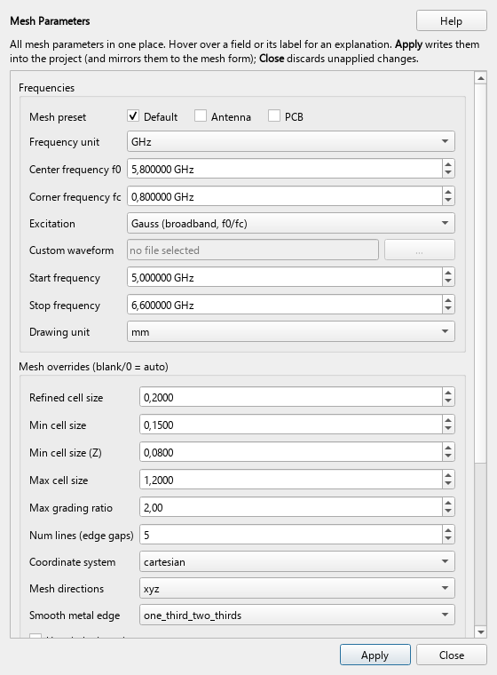

### Step 13 - Build the mesh

**Where:** **Mesh -> Build Mesh** (Ctrl+M), or the **Build Mesh** button on the Mesh tab

**Do:**

- easyMesh resolves the 0.5 mm gap and the copper edges.
- The Mesh Viewer opens the XY slice at z = 1.6 mm.
- Toggle **Mesh grid** in the viewer to inspect the lines.

**Check:** The gap and the metal edges contain several grid lines; the air cells are larger.

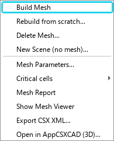

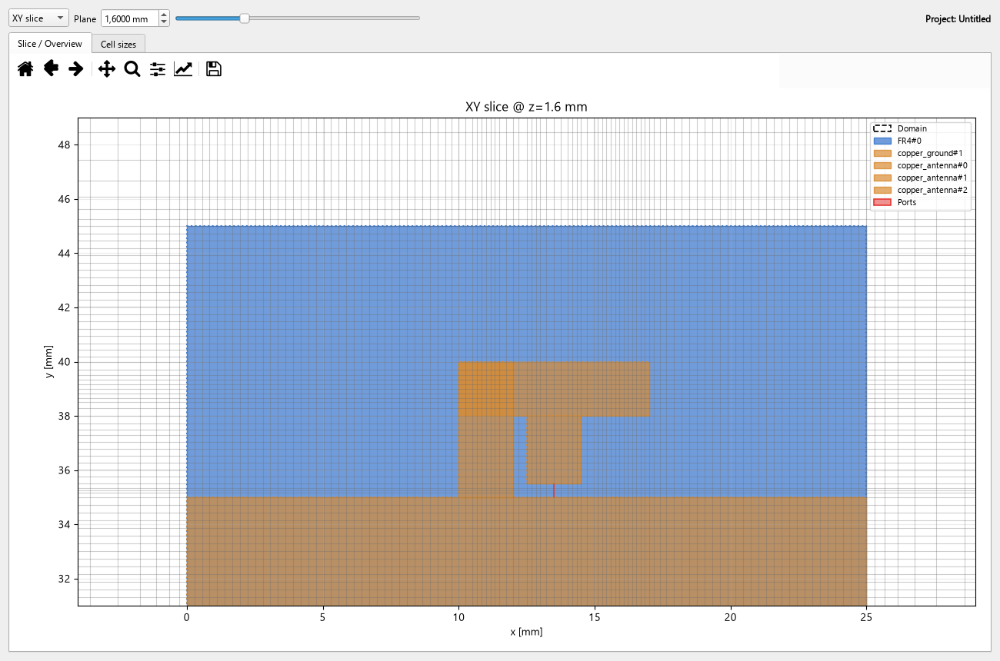

### Step 14 - Check the mesh quality

**Where:** **Mesh Viewer** -> tab **Slice / Overview** / **Cell sizes**

**Do:**

- Use **Cell sizes** for the cell-size distribution.
- Right-click the viewer for **Critical cells** and the runtime overlay.
- If the gap has too few cells, lower the min cell size and rebuild.

**Check:** The finest cells sit at the feed gap and the metal edges; no unexpected slivers.


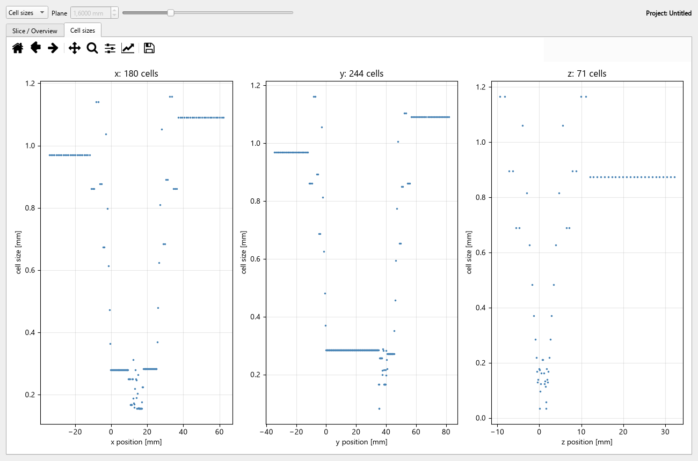

### Step 15 - Run the FDTD simulation

**Where:** **Simulation -> Run Simulation** (Ctrl+R), or the **Run Simulation** button

**Do:**

- Watch the timestep bar and the energy bar in the status line.
- openEMS stops when the energy criterion is reached.
- The log lists the S-parameter and NF2FF files and the runtime.

**Check:** The log ends with `Simulation finished`; the S-Params and Antenna tabs have data.

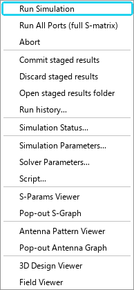

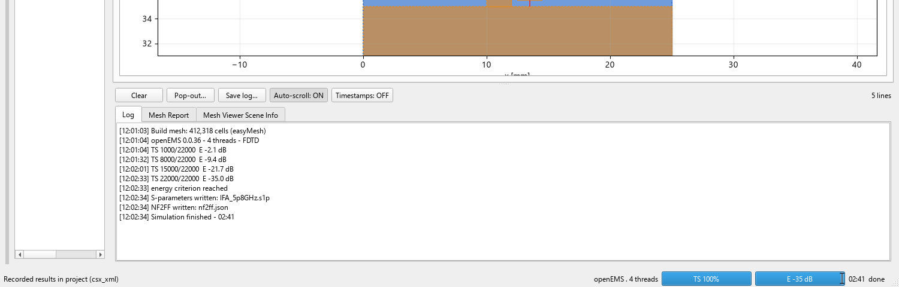

### Step 16 - Read the S-parameters

**Where:** tab **S-Params**; plot selector at the top, trace list on the left

**Do:**

- Plot **|S| dB**; the dip is at **5.80 GHz**.
- Click the plot to add a marker; the marker list shows |S11| = **-28.17 dB**, VSWR **1.08**.
- Use **Preset -> Return loss (Sii)** for a single curve.
- The **Plot** selector also offers Smith, VSWR, phase and Re/Im.

**Check:** |S11| < -10 dB from about **5.65 to 5.95 GHz**.


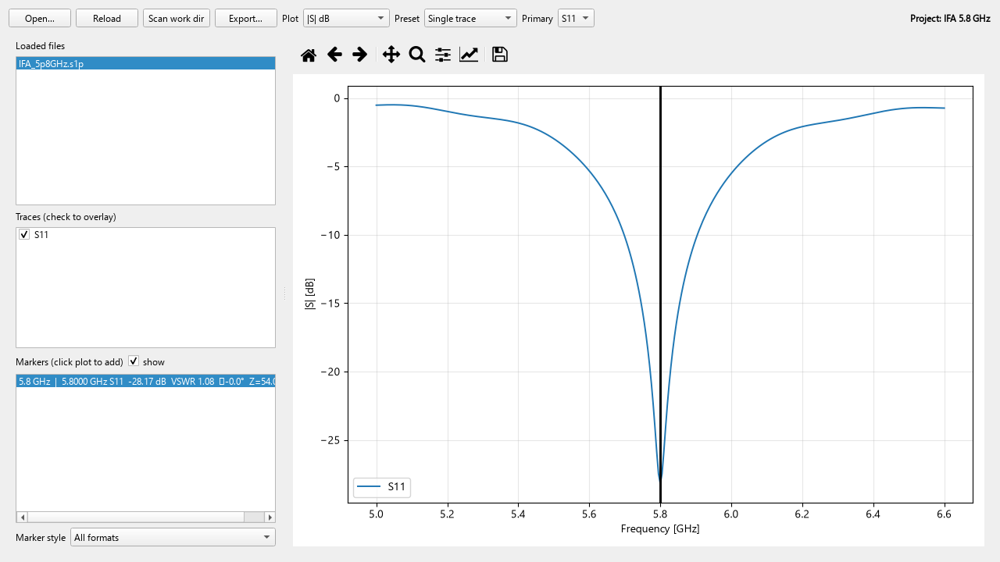

### Step 17 - Read the antenna pattern

**Where:** tab **Antenna**; Plot selector and Freq selector at the top

**Do:**

- Plot **3D Pattern**, field **Gain**, frequency **5.8 GHz**.
- Use **E-Plane (phi=90)** and **H-Plane (phi=0)** for cuts.
- Markers read gain, angle and HPBW; the details panel shows Dmax and efficiency.

**Check:** Maximum gain about **2.6 dBi**, efficiency **68 %**, Dmax 3.15 dBi.


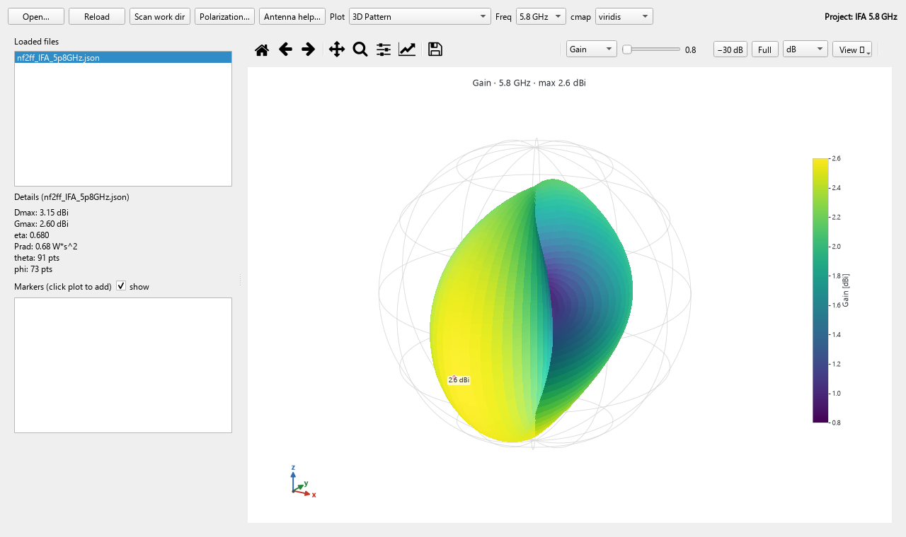

### Step 18 - Inspect the E-field

**Where:** tab **Field Viewer**; **Data** panel on the left

**Do:**

- Array **pt:magnitude**; Show **Surface**; View **Fit (keep direction)**.
- Slice **XY** at z = 1.6 mm for the top-copper distribution.
- A **YZ** cut at x = 13.5 mm shows the field across the feed gap.
- Use **Colour** (auto/min/max/log) and the time/frequency slider to animate.

**Check:** The hot spot sits at the 0.5 mm gap and along the arm; the field decays into the air.


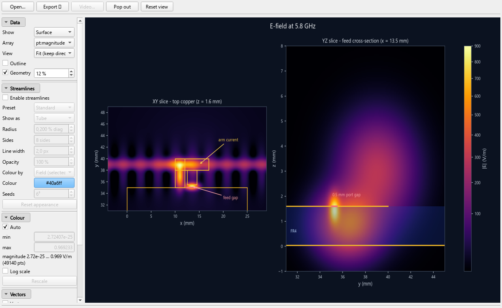

## Viewer controls cheat sheet

**S-Params tab.** Top bar: Open, Reload, Scan work dir, Export, Plot,
Preset, Primary. Left: loaded files, trace checkboxes, markers. Plot
options: Smith, |S| dB, Return loss, |S| mag, Phase, VSWR, Re/Im,
Z Re/Im. Click the plot to add a marker; right-click for smart actions.

**Antenna tab.** Top bar: Open, Reload, Polarization, Plot, Freq, cmap.
Plot options: E-Plane, H-Plane, Azimuth, Axial Ratio, Gain vs Frequency,
Efficiency, 3D Pattern. The 3D toolbar controls Gain/Dmax, the dB floor,
Full/zoom, radius mapping and the view preset.

**Field Viewer tab.** Data panel: Show, Array, View, Outline, Geometry.
Colour panel: Auto, min, max, Log scale, Rescale. Slice panel: axis and
position. Vectors/Streamlines panels add arrows, tubes or streamlines.
The time/frequency slider animates a series; File -> Export renders MP4/GIF.

## Reproduce the assets

```bash
python docs/tutorial/generate_tutorial.py
```

This regenerates the screenshots, the twenty slides (in `frames/`) and
the MP4. Install `ffmpeg` for the video step; the PNG frames are
written even without it.

## Files

- `IFA_5p8GHz_Tutorial.mp4` - 90 s, 1600 x 900, H.264, no audio.
- `frames/01.png` ... `frames/20.png` - the twenty slides.
- `assets/` - GUI screenshots, menu/tab highlight cards, diagrams and field maps.
- `generate_tutorial.py` - regenerates all of the above.

## Notes

- The geometry is a starting point, not a tuned production antenna.
  Expect the resonance to move with substrate tolerances and the feed
  detail; tune the arm length and the feed offset on your own board.
- Increase `end_criteria` or `max_timesteps` for a smoother S-parameter
  curve; a finer mesh costs runtime.
- The Field Viewer can also animate a time series and overlay vectors
  or streamlines; the same data can be opened in ParaView.
