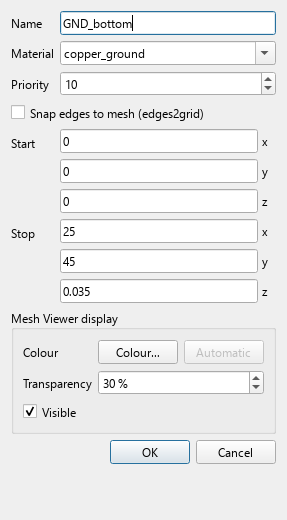
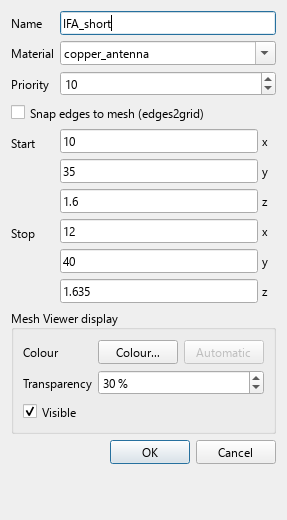

# Inverted-F Antenna on a PCB - 5.8 GHz tutorial

[Watch the MP4 (narrated, ambient soundtrack)](IFA_5p8GHz_Tutorial.mp4)

[Deep Techno version](IFA_5p8GHz_Tutorial_DeepTechno.mp4)


A detailed VisualOpenEMS walkthrough. Every element of the antenna is
introduced separately: substrate, bottom ground, top ground with the
antenna clearance, radiating arm, shorting stub, feed strip, feed gap and
lumped port. Each step names the exact menu path or tab and shows a
screenshot with the target highlighted.

> The GUI screenshots are real. The S-parameter curve, pattern and
> field maps use representative IFA data so the viewers can be explained
> without a long FDTD run; your own results will differ with geometry,
> mesh and materials.

## Antenna elements

All coordinates are in **mm**, x = board width, y = board length, z = up
through the substrate. **Start** is the lower corner and **Stop** the
upper corner. Copper primitives use priority 10; the substrate uses 1.

| Element | Role | Start (mm) | Stop (mm) | Material | Priority |
| --- | --- | --- | --- | --- | --- |
| PCB_FR4 | substrate | 0 / 0 / 0 | 25 / 45 / 1.6 | FR4 | 1 |
| GND_bottom | return/reference plane | 0 / 0 / 0 | 25 / 45 / 0.035 | copper | 10 |
| GND_top | local feed reference | 0 / 0 / 1.6 | 25 / 35 / 1.635 | copper | 10 |
| IFA_arm | radiator, 7 x 2 mm | 10 / 38 / 1.6 | 17 / 40 / 1.635 | copper | 10 |
| IFA_short | shorting stub, 2 x 5 mm | 10 / 35 / 1.6 | 12 / 40 / 1.635 | copper | 10 |
| IFA_feed | feed strip, 2 x 2.5 mm | 12.5 / 35.5 / 1.6 | 14.5 / 38 / 1.635 | copper | 10 |
| feed gap | empty 0.5 mm | x 12.5...14.5, y 35.0...35.5, z = 1.6 | - | - | - |
| port | lumped, 50 ohm | 13.5 / 35.5 / 1.6 | 13.5 / 35.0 / 1.6 | - | - |

The **antenna clearance** is not a separate object: it is the area
y = 35...45 mm where the top copper is absent. The **feed gap** is the
0.5 mm empty space between IFA_feed and GND_top; the lumped port spans it.

> **Model simplification:** the top and bottom grounds are separate
> copper boxes here. A production board would connect them with stitching
> vias; this tutorial keeps the model small and uses the PEC zmin
> boundary as the global return.

## GUI map

| Region | What it is for |
| --- | --- |
| Menu bar | File, Geometry, Mesh, Simulation, View, Settings, Help |
| Project / Geometry tree | Primitives, materials, ports, dumps, NF2FF box |
| Tabs | Geometry, Mesh Viewer, 3D Design, S-Params, Antenna, Field Viewer |
| Status bar | Timestep/energy progress, runtime, log toggle |

## Video chapters

| Time | Chapter |
| --- | --- |
| 00:00 | Title and overview |
| 00:13 | Step 1 - The main window |
| 00:44 | Step 2 - Start a new project |
| 00:58 | Step 3 - Set the frequency range |
| 01:16 | Step 4 - Create the FR4 material |
| 01:32 | Step 5 - Add the PCB substrate |
| 01:55 | Step 6 - Bottom ground plane - GND_bottom |
| 02:15 | Step 7 - Top ground plane - GND_top |
| 02:41 | Step 8 - Radiating arm - IFA_arm |
| 03:02 | Step 9 - Shorting stub - IFA_short |
| 03:23 | Step 10 - Feed strip and feed gap - IFA_feed |
| 03:52 | Step 11 - Add the 50 ohm feed port |
| 04:14 | Step 12 - Add the E-field dump |
| 04:29 | Step 13 - Enable the NF2FF far field |
| 04:49 | Step 14 - Set the mesh parameters |
| 05:06 | Step 15 - Build the mesh |
| 05:20 | Step 16 - Check the mesh quality |
| 05:34 | Step 17 - Run the FDTD simulation |
| 05:49 | Step 18 - Read the S-parameters |
| 06:07 | Step 19 - Read the antenna pattern |
| 06:22 | Step 20 - Inspect the E-field |
| 06:38 | Summary and tuning tips |

## Steps

### Step 1 - The main window

**Where:** the window that opens when VisualOpenEMS starts

**Do:**

- Menu bar: **File**, **Presets**, **Geometry**, **Mesh**, **Simulation**, **View**, **Settings**, **Help**.
- Left panel **Project / Geometry**: every primitive, material, port, dump and NF2FF box.
- Tabs: **Geometry**, **Mesh Viewer**, **3D Design**, **S-Params**, **Antenna**, **Field Viewer**.
- Bottom bar: run status, timestep/energy bars, runtime and the log toggle.

**Check:** The project tree and the tabs are the two places you will use most.


### Step 2 - Start a new project

**Where:** **File -> New Project** (Ctrl+N)

**Do:**

- Choose a work folder under **Settings -> Settings...** if needed.
- Save with **File -> Save** (Ctrl+S); geometry, mesh, ports and results are stored in one `.fcsim.json`.

**Check:** The window title shows the project name; the tree is ready for objects.


### Step 3 - Set the frequency range

**Where:** **Simulation -> Simulation Parameters...** (Ctrl+Shift+P), tab **Simulation-Parameter**

**Do:**

- Drawing unit **mm**; start **5.0 GHz**, stop **6.6 GHz**, target **5.8 GHz**.
- Boundary: PML on all sides, **zmin = PEC** (ground reference).
- Press **Apply**; the computed block shows max cell 1.2 mm and the air margin.

**Check:** The computed block lists 5.0 / 6.6 / 5.8 GHz and max cell lambda/10 = 1.2 mm.


### Step 4 - Create the FR4 material

**Where:** **Geometry -> Add Material...**

**Do:**

- Name **FR4**, kind **dielectric**.
- eps_r = **4.4**, kappa = 0, tan_d = **0.02**.
- Press **OK**; FR4 appears under Materials.

**Check:** The material row shows FR4 (dielectric) with eps_r 4.4.


### Step 5 - Add the PCB substrate

**Where:** **Geometry -> Add Box...**

**Do:**

- Name **PCB_FR4**, material **FR4**, priority **1**.
- Start **0 / 0 / 0 mm**, Stop **25 / 45 / 1.6 mm**.
- Start is the lower corner, Stop the upper corner; x = board width, y = board length, z = through the substrate.

**Check:** The tree shows Prim: PCB_FR4; the mesh viewer draws the blue substrate.


### Step 6 - Bottom ground plane - GND_bottom

**Where:** **Geometry -> Add Box...**

**Do:**

- Start **0 / 0 / 0 mm**, Stop **25 / 45 / 0.035 mm**.
- Material **copper**, priority **10**.
- It covers the whole board: return/reference plane; the zmin boundary is also PEC.

**Check:** The bottom copper covers the full board and is visible as the reference plane.




### Step 7 - Top ground plane - GND_top

**Where:** **Geometry -> Add Box...**

**Do:**

- Start **0 / 0 / 1.6 mm**, Stop **25 / 35 / 1.635 mm**.
- Material **copper**, priority **10**.
- It stops at y = 35 mm. The strip **y = 35...45 mm** is the 10 mm antenna clearance - no box, just the absence of top copper.
- It is the local feed reference. A production board would stitch it to the bottom ground with vias.

**Check:** In the XY slice at z = 1.6 mm the top copper covers y = 0...35 only.


### Step 8 - Radiating arm - IFA_arm

**Where:** **Geometry -> Add Box...**

**Do:**

- Start **10 / 38 / 1.6 mm**, Stop **17 / 40 / 1.635 mm**.
- Material **copper**, priority **10**; 7 mm long, 2 mm wide.
- The open end is at x = 17 mm; this is the main radiator.

**Check:** The top view shows the horizontal arm at the ground edge.


### Step 9 - Shorting stub - IFA_short

**Where:** **Geometry -> Add Box...**

**Do:**

- Start **10 / 35 / 1.6 mm**, Stop **12 / 40 / 1.635 mm**.
- Material **copper**, priority **10**; 2 mm wide, 5 mm high.
- It connects the arm at y = 40 to the top ground at y = 35 and sets the quarter-wave resonance.

**Check:** The short is the vertical strip at the left end of the arm.




### Step 10 - Feed strip and feed gap - IFA_feed

**Where:** **Geometry -> Add Box...**

**Do:**

- Start **12.5 / 35.5 / 1.6 mm**, Stop **14.5 / 38 / 1.635 mm**.
- Material **copper**, priority **10**; 2 mm wide.
- It connects the arm at y = 38 to the feed point at y = 35.5. The **0.5 mm gap** y = 35.0...35.5 to GND_top is the port gap - no box.

**Check:** The feed is the middle vertical strip; the gap to the top ground is clearly visible.


### Step 11 - Add the 50 ohm feed port

**Where:** **Geometry -> Add Port...** (also Ports / Dumps, Ctrl+Shift+D)

**Do:**

- Type **lumped**, resistance **50 ohm**, direction **y**.
- Width (lumped): **Area - as wide as the metal (x)**.
- Start **13.5 / 35.5 / 1.6 mm**, Stop **13.5 / 35.0 / 1.6 mm**.
- Metal reference **IFA_feed**; the list marks `area along X`.

**Check:** The port spans the 0.5 mm gap and is 2 mm wide, exactly the feed strip width.


### Step 12 - Add the E-field dump

**Where:** **Geometry -> Add Field Dump...**

**Do:**

- Name **E_5p8**, quantity **E**, frequency **5.8 GHz**, file type **VTK (.vtr)**.
- Box **-5 / 28 / -3** to **30 / 47 / 14 mm**; optional resolution 0.2 mm.
- Enable **Frequency domain** and **Enabled**.

**Check:** The tree lists Dump: E_5p8 (E); the Field Viewer will read the .vtr file.


### Step 13 - Enable the NF2FF far field

**Where:** **Simulation -> Simulation Parameters...** -> tab **NF2FF-Parameter**

**Do:**

- Tick **Enable far-field (NF2FF)**.
- Mode **Frequency list**, frequencies **5.8 GHz**.
- Box placement **Automatic**, theta steps **181**, phi steps **361**.

**Check:** The tree shows NF2FF: on; the pattern will be evaluated at 5.8 GHz.


### Step 14 - Set the mesh parameters

**Where:** **Mesh -> Mesh Parameters...** (Ctrl+Shift+M)

**Do:**

- Max cell **1.2 mm**, min cell **0.15 mm**, min z cell **0.08 mm**.
- Refined cell **0.2 mm**, max grading ratio **2.0**, 18 cells per wavelength.
- Press **Apply** to write them into the project.

**Check:** The dialog shows the values above; the mesh report will quote them.


### Step 15 - Build the mesh

**Where:** **Mesh -> Build Mesh** (Ctrl+M), or the **Build Mesh** button

**Do:**

- easyMesh resolves the 0.5 mm gap and the copper edges.
- The Mesh Viewer opens the XY slice at z = 1.6 mm.
- Toggle **Mesh grid** to inspect the lines.

**Check:** The gap and the metal edges contain several grid lines; air cells are larger.


### Step 16 - Check the mesh quality

**Where:** **Mesh Viewer** -> **Slice / Overview** / **Cell sizes**

**Do:**

- Use **Cell sizes** for the distribution.
- Right-click the viewer for **Critical cells** and the runtime overlay.
- If the gap has too few cells, lower the min cell size and rebuild.

**Check:** The finest cells sit at the feed gap and the metal edges; no unexpected slivers.


### Step 17 - Run the FDTD simulation

**Where:** **Simulation -> Run Simulation** (Ctrl+R)

**Do:**

- Watch the timestep and energy bars in the status line.
- openEMS stops when the energy criterion is reached.
- The log lists the S-parameter and NF2FF files and the runtime.

**Check:** The log ends with `Simulation finished`; S-Params and Antenna have data.


### Step 18 - Read the S-parameters

**Where:** tab **S-Params**; plot selector at the top, trace list left

**Do:**

- Plot **|S| dB**; the dip is at **5.80 GHz**.
- Click the plot to add a marker; |S11| = **-28.17 dB**, VSWR **1.08**.
- Use **Preset -> Return loss (Sii)**; the Plot menu also offers Smith, VSWR, phase, Re/Im.

**Check:** |S11| < -10 dB from about **5.65 to 5.95 GHz**.


### Step 19 - Read the antenna pattern

**Where:** tab **Antenna**; Plot and Freq selectors at the top

**Do:**

- Plot **3D Pattern**, field **Gain**, frequency **5.8 GHz**.
- Use **E-Plane (phi=90)** and **H-Plane (phi=0)** for cuts.
- Markers read gain, angle and HPBW; the details panel shows Dmax and efficiency.

**Check:** Maximum gain about **2.6 dBi**, efficiency **68 %**, Dmax 3.15 dBi.


### Step 20 - Inspect the E-field

**Where:** tab **Field Viewer**; **Data** panel on the left

**Do:**

- Array **pt:magnitude**; Show **Surface**; View **Fit (keep direction)**.
- Slice **XY** at z = 1.6 mm for the top copper.
- A **YZ** cut at x = 13.5 mm shows the field across the feed gap.
- Use **Colour** and the time/frequency slider to animate.

**Check:** The hot spot sits at the 0.5 mm gap and along the arm; the field decays into air.


## Summary and tuning

The example results are |S11| = -28 dB at 5.80 GHz, a -10 dB band
from about 5.65 to 5.95 GHz, 2.6 dBi gain and 68 % efficiency. To tune:

- **Arm length** shifts the resonance: longer -> lower frequency.
- **Arm height** changes bandwidth and radiation resistance.
- **Feed offset** matches the 50 ohm feed without a matching network.
- **Ground clearance** affects efficiency and the pattern shape.

Change one dimension at a time, rebuild the mesh and compare S11 and the pattern.

## Viewer controls cheat sheet

**S-Params tab.** Top bar: Open, Reload, Scan work dir, Export, Plot,
Preset, Primary. Left: loaded files, trace checkboxes, markers. Plot
options: Smith, |S| dB, Return loss, |S| mag, Phase, VSWR, Re/Im,
Z Re/Im. Click the plot to add a marker; right-click for smart actions.

**Antenna tab.** Top bar: Open, Reload, Polarization, Plot, Freq, cmap.
Plot options: E-Plane, H-Plane, Azimuth, Axial Ratio, Gain vs Frequency,
Efficiency, 3D Pattern. The 3D toolbar controls Gain/Dmax, the dB floor,
Full/zoom, radius mapping and the view preset.

**Field Viewer tab.** Data panel: Show, Array, View, Outline, Geometry.
Colour panel: Auto, min, max, Log scale, Rescale. Slice panel: axis and
position. Vectors/Streamlines panels add arrows, tubes or streamlines.
The time/frequency slider animates a series; File -> Export renders MP4/GIF.

## Reproduce the assets

```bash
python docs/tutorial/generate_tutorial.py
python docs/tutorial/generate_narration.py
```

The first command regenerates the screenshots, the 22 slides, the silent
MP4 and the narration metadata. The second speaks every slide with the
offline Windows voice **Microsoft David**, adapts each slide duration to
the narration (at least twice the old hold) and mixes the music underneath.
Install `ffmpeg` for the video step; the PNG frames are written even
without it.

## Narrator and music

Every slide is narrated in English by the offline Windows voice
**Microsoft David**. The script is built from the slide title, the caption
and the side-card values, so the video says what is on screen.

The soundtrack is original, programmatically synthesized music - no
third-party samples. Two versions are provided:

- `IFA_5p8GHz_Tutorial.mp4` - ambient pad, sub bass and sparse plucks
  (default soundtrack).
- `IFA_5p8GHz_Tutorial_DeepTechno.mp4` - 124 BPM deep techno with a
  rolling bassline, kick, hats and atmospheric pad.

The voice is normalized to about -17 LUFS; the music is mixed much lower
and ducked while the narrator speaks, so the explanations stay clear.
Temporary WAVs live only in the build folder.

## Files

- `IFA_5p8GHz_Tutorial.mp4` - 410 s, 1280 x 720, H.264 + AAC, narrated + ambient.
- `IFA_5p8GHz_Tutorial_DeepTechno.mp4` - narrated + deep techno.
- `frames/01.png` ... `frames/22.png` - the 22 slides.
- `assets/` - GUI screenshots, highlight cards, diagrams, field maps and narration JSON.
- `generate_tutorial.py`, `generate_narration.py`, `generate_music.py` - rebuild the video, voice and music.

## Notes

- The geometry is a starting point, not a tuned production antenna.
  Expect the resonance to move with substrate tolerances and the feed
  detail; tune the arm length and the feed offset on your own board.
- Increase `end_criteria` or `max_timesteps` for a smoother S-parameter
  curve; a finer mesh costs runtime.
- The Field Viewer can also animate a time series and overlay vectors
  or streamlines; the same data can be opened in ParaView.
